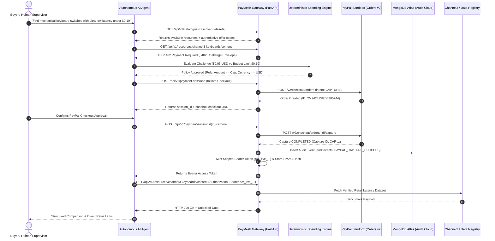

# PayMesh AI

<div align="center">

```text
  ██████╗  █████╗ ██╗   ██╗███╗   ███╗███████╗███████╗██╗  ██╗     █████╗ ██╗
  ██╔══██╗██╔══██╗╚██╗ ██╔╝████╗ ████║██╔════╝██╔════╝██║  ██║    ██╔══██╗██║
  ██████╔╝███████║ ╚████╔╝ ██╔████╔██║█████╗  ███████╗███████║    ███████║██║
  ██╔═══╝ ██╔══██║  ╚██╔╝  ██║╚██╔╝██║██╔══╝  ╚════██║██╔══██║    ██╔══██║██║
  ██║     ██║  ██║   ██║   ██║ ╚═╝ ██║███████╗███████║██║  ██║    ██║  ██║██║
  ╚═╝     ╚═╝  ╚═╝   ╚═╝   ╚═╝     ╚═╝╚══════╝╚══════╝╚═╝  ╚═╝    ╚═╝  ╚═╝╚═╝
```

### A Trust & Payment Infrastructure for Autonomous AI Commerce
**Official Submission for the PayPal AI Hackathon 2026**

[](https://paypal-hackathon-mu.vercel.app/)
[](https://paypal-hackathon-s0gq.onrender.com/health)
[](https://developer.paypal.com)
[](https://ai.google.dev/)
[](https://www.mongodb.com/atlas)
[](https://www.ag-grid.com)
[](https://L402.org)
[](https://modelcontextprotocol.io/)
[](backend/tests/)
[](LICENSE)

[🌐 Live Frontend](https://paypal-hackathon-mu.vercel.app/) • [⚡ Live Backend](https://paypal-hackathon-s0gq.onrender.com) • [📸 Visual Showcase](#-dashboard-screenshots--visual-showcase) • [💡 Overview](#-overview) • [⚡ Key Features](#-key-features) • [🛠 Tech Stack](#-technology-stack) • [🏛 Architecture](#-system-architecture) • [🔄 Workflows](#-end-to-end-workflows) • [🚀 Quick Start](#-installation--setup) • [🔐 Environment Variables](#-environment-variables) • [📡 API Docs](#-api-documentation) • [🧪 Testing](#-testing--quality-checks) • [🏆 Hackathon Tracks](#-hackathon-prize-track-alignment)

</div>

---

## 🌐 Live Deployments & Verification Endpoints

| Component | Provider | Live URL | Status |
| :--- | :--- | :--- | :--- |
| **Production Frontend** | Vercel (Edge CDN) | [https://paypal-hackathon-mu.vercel.app/](https://paypal-hackathon-mu.vercel.app/) |  |
| **API Backend Gateway** | Render Web Service | [https://paypal-hackathon-s0gq.onrender.com](https://paypal-hackathon-s0gq.onrender.com) |  |
| **System Diagnostics** | Render `/health` | [https://paypal-hackathon-s0gq.onrender.com/health](https://paypal-hackathon-s0gq.onrender.com/health) |  |
| **PayPal Sandbox Webhook** | PayPal Developer Portal | `https://paypal-hackathon-s0gq.onrender.com/api/v1/payments/webhook` |  |
| **MongoDB Atlas Cluster** | MongoDB Atlas Cloud | `cluster0.mfzju4v.mongodb.net/cohesora` (v8.0.37) |  |
| **Interactive OpenAPI Docs** | Swagger UI | [https://paypal-hackathon-s0gq.onrender.com/docs](https://paypal-hackathon-s0gq.onrender.com/docs) |  |
| **MCP Server Manifest** | Model Context Protocol | [https://paypal-hackathon-s0gq.onrender.com/api/v1/agent/mcp/manifest](https://paypal-hackathon-s0gq.onrender.com/api/v1/agent/mcp/manifest) |  |

---

## 📸 Dashboard Screenshots & Visual Showcase

Every screenshot below reflects the genuine running application in its authentic **Neo-Tech** design system (inspired by developer engineering schematics and Major League Hacking aesthetic):

### 1. AI Commerce Agent Studio & Mission Control
The unified interface where developers and autonomous buyer agents formulate tasks, enforce spending policies, review tool trace logs, and inspect protocol state transitions in real time.


*Figure 1: PayMesh AI workspace with research goal formulate input, spending policy ceilings, and the live Protocol Inspector terminal.*

---

### 2. Machine-Readable L402 Challenge & PayPal Gateway
When an agent accesses monetized datasets without credentials, the gateway issues an authoritative `HTTP 402 Payment Required` challenge. The agent's deterministic spending engine evaluates the pre-negotiated offer and triggers the PayPal Sandbox Orders v2 checkout lifecycle.


*Figure 2: Real-time HTTP 402 Challenge card presenting the verified offer, deterministic policy clearance, and the PayPal Sandbox approval action.*

---

### 3. Decrypted Intelligence & Channel3 Product Data
Upon server-side capture of the PayPal transaction, a cryptographic scoped Bearer token (`pm_live_...`) is minted, unlocking normalized Channel3 hardware latency benchmarks with direct retailer links.


*Figure 3: Unlocked dataset presentation displaying measured switch latencies, retail pricing, AI market synthesis, and Bearer token copy utility.*

---

### 4. Deterministic Trust & Spending Policy Engine
Guardrails that prevent probabilistic LLM agents from runaway spending or falling victim to prompt injection. Server-enforced financial limits evaluate database records independently of the model.


*Figure 4: Spending Policy Engine showing per-transaction ceilings, 24-hour daily rolling caps, prompt-injection sanitization, and security invariants.*

---

### 5. API & Data Marketplace Catalogue
A machine-readable registry where data providers list intelligence datasets, hardware benchmarks, and pricing offers for programmatic discovery.


*Figure 5: Dataset marketplace featuring live search, pricing tier summaries, raw HTTP 402 endpoint testing, and one-click agent dispatch.*

---

### 6. AG Grid Financial Ledger & KPI Analytics
Enterprise-grade financial analytics tracking captured transaction volume, active entitlements, conversion rates, and immutable PayPal capture IDs.


*Figure 6: Interactive AG Grid financial ledger with sorting, filtering, CSV export, and real-time PayPal Sandbox capture verification.*

---

### 7. Merchant Publishing Studio
A self-service portal for third-party data providers to register new datasets, set pricing tiers, and generate live AI agent card previews.


*Figure 7: Merchant publishing interface with custom slug generator, provider selector, offer pricing models, and instant live card preview.*

---

## 💡 Overview

### The Problem: Autonomous Agents Cannot Hold Credit Cards
The world is transitioning to autonomous software agents capable of conducting research, purchasing data, and provisioning APIs on behalf of users. However:
1. **Agents cannot be trusted with raw financial credentials**: Exposing static API keys or corporate credit cards to an LLM creates catastrophic risks of prompt injection, rogue spending loops, and credential exfiltration.
2. **Traditional payment flows require human web browsers**: Redirect loops, cookie-based sessions, and multi-factor captchas break programmatic workflows.
3. **Data providers lack machine paywalls**: Web scrapers bypass monetized paywalls while legitimate bots cannot programmatically pay for single queries.

### The Solution: PayMesh AI
**PayMesh AI** solves this by establishing a **standardized trust and settlement mesh for autonomous AI agents** using the open **L402 protocol** and **PayPal Developer Sandbox (Orders v2 & Webhooks)**:

- **Machine-Readable 402 Paywalls**: Programmatic clients receive structured JSON challenges specifying verified pricing offers, expiration timestamps, and payment endpoints.
- **Genuine PayPal Sandbox Settlement**: Full Orders v2 lifecycle—OAuth 2.0 client authentication, server-calculated purchase units, approval delegation, and server-side capture verification.
- **Deterministic Trust Engine**: The LLM is strictly prohibited from authorizing payments or changing amounts. All financial gates evaluate database records deterministically.
- **Dual Persistence Architecture**: Relational models (PostgreSQL/SQLite) manage transactional session states, while **MongoDB Atlas** provides immutable audit logging and document storage.
- **Cryptographic Token Separation**: Challenge IDs, PayPal Order IDs, and Bearer Tokens are strictly separated. Only salted HMAC-SHA256 hashes of `pm_live_...` tokens are stored.
- **Model Context Protocol (MCP)**: Native integration enabling Claude Desktop and MCP-compliant autonomous runtimes to discover, negotiate, and unlock paid data natively.
- **Remotion Pitch Composition**: Full 60s 1080p programmatic video pitch rendered natively via Remotion React code in `remotion/`.

---

## ⚡ Key Features

| Feature | Description | Architecture / Implementation |
| :--- | :--- | :--- |
| **PayMesh L402 Protocol** | Returns standardized `HTTP 402 Payment Required` envelopes with challenge IDs, resource metadata, server-derived pricing offers, and settlement endpoints. | [`backend/app/services/challenge_service.py`](file:///c:/Users/LENOVO/OneDrive/Desktop/paypal-hackathon/backend/app/services/challenge_service.py) |
| **PayPal Orders v2 Capture** | Genuine PayPal Sandbox integration: OAuth 2.0 token acquisition, purchase unit creation, approval flow, and server-side capture verification. | [`backend/app/services/paypal_gateway.py`](file:///c:/Users/LENOVO/OneDrive/Desktop/paypal-hackathon/backend/app/services/paypal_gateway.py) |
| **PayPal Webhook Receiver** | Dedicated webhook handler receiving real-time asynchronous PayPal events (`PAYMENT.CAPTURE.COMPLETED`), acknowledging `200 OK`, and logging to MongoDB. | [`backend/app/api/v1/routes/payments.py`](file:///c:/Users/LENOVO/OneDrive/Desktop/paypal-hackathon/backend/app/api/v1/routes/payments.py) |
| **Deterministic Spending Engine** | Enforces hard ceilings per transaction, rolling 24-hour budgets, and currency matching. The LLM cannot alter amounts or bypass rules. | [`backend/app/agent/policy.py`](file:///c:/Users/LENOVO/OneDrive/Desktop/paypal-hackathon/backend/app/agent/policy.py) |
| **Google Gemini & Multi-LLM** | Native Google Gemini 2.5 Flash / 3.8 Flash live integration (`AI_PROVIDER=gemini`) alongside OpenAI GPT-4o-mini and Claude fallback. | [`backend/app/agent/llm_client.py`](file:///c:/Users/LENOVO/OneDrive/Desktop/paypal-hackathon/backend/app/agent/llm_client.py) |
| **MongoDB Atlas Audit Ledger** | Persistent document and event tracking in MongoDB Atlas `cohesora` cluster (`auditevents` collection) with TLS `certifi` verification. | [`backend/app/db/mongodb.py`](file:///c:/Users/LENOVO/OneDrive/Desktop/paypal-hackathon/backend/app/db/mongodb.py) |
| **Model Context Protocol (MCP)** | Standardized server exposed at `/api/v1/agent/mcp/manifest` allowing any MCP-compliant agent to discover and purchase datasets programmatically. | [`backend/app/mcp/server.py`](file:///c:/Users/LENOVO/OneDrive/Desktop/paypal-hackathon/backend/app/mcp/server.py) |
| **Channel3 Intelligence** | Integrated product data provider offering retail hardware switch profiles, latency benchmarks, and verified retailer links. | [`backend/app/services/channel3_client.py`](file:///c:/Users/LENOVO/OneDrive/Desktop/paypal-hackathon/backend/app/services/channel3_client.py) |
| **AG Grid Financial Ledger** | Enterprise AG Grid Community table providing financial auditing, real-time KPI aggregations, and PayPal capture tracking with CSV export. | [`frontend/src/components/AnalyticsView.tsx`](file:///c:/Users/LENOVO/OneDrive/Desktop/paypal-hackathon/frontend/src/components/AnalyticsView.tsx) |
| **Remotion Programmatic Video** | 60-second 1080p full video pitch demo rendered completely via Remotion React components in `remotion/`. | [`remotion/src/PayMeshDemo.tsx`](file:///c:/Users/LENOVO/OneDrive/Desktop/paypal-hackathon/remotion/src/PayMeshDemo.tsx) |

---

## 🛠 Technology Stack

| Layer / Technology | Role in PayMesh AI | Codebase Location |
| :--- | :--- | :--- |
| **Python 3.11+ / FastAPI** | High-performance asynchronous API gateway, L402 paywall middleware, and business logic. | [`backend/app/main.py`](file:///c:/Users/LENOVO/OneDrive/Desktop/paypal-hackathon/backend/app/main.py), [`backend/app/api/`](file:///c:/Users/LENOVO/OneDrive/Desktop/paypal-hackathon/backend/app/api/) |
| **PayPal Developer Platform** | Payment settlement gateway using PayPal Orders v2 Sandbox APIs and asynchronous Webhook events. | [`backend/app/services/paypal_gateway.py`](file:///c:/Users/LENOVO/OneDrive/Desktop/paypal-hackathon/backend/app/services/paypal_gateway.py) |
| **Google Gemini AI** | Advanced reasoning model (`gemini-2.5-flash`) interpreting tasks, selecting datasets, and synthesizing unlocked intelligence. | [`backend/app/agent/llm_client.py`](file:///c:/Users/LENOVO/OneDrive/Desktop/paypal-hackathon/backend/app/agent/llm_client.py) |
| **MongoDB Atlas Cloud** | Persistent audit log repository (`cohesora` database) storing immutable transaction histories and webhook receipts. | [`backend/app/db/mongodb.py`](file:///c:/Users/LENOVO/OneDrive/Desktop/paypal-hackathon/backend/app/db/mongodb.py) |
| **SQLAlchemy 2.0 (Async)** | Asynchronous ORM managing relational entities: Resources, Offers, Challenges, Orders, Entitlements, Events. | [`backend/app/models/entities.py`](file:///c:/Users/LENOVO/OneDrive/Desktop/paypal-hackathon/backend/app/models/entities.py) |
| **Pydantic v2** | Strict schema validation, request/response models, and environment settings parsing. | [`backend/app/schemas/`](file:///c:/Users/LENOVO/OneDrive/Desktop/paypal-hackathon/backend/app/schemas/), [`backend/app/core/config.py`](file:///c:/Users/LENOVO/OneDrive/Desktop/paypal-hackathon/backend/app/core/config.py) |
| **React 18 + Vite** | High-speed frontend build serving the interactive AI Commerce Agent Portal. | [`frontend/src/`](file:///c:/Users/LENOVO/OneDrive/Desktop/paypal-hackathon/frontend/src/) |
| **Tailwind CSS + Neo-Tech** | Modern developer-focused design system with blueprint grids, tactile borders, and hard shadows. | [`frontend/tailwind.config.js`](file:///c:/Users/LENOVO/OneDrive/Desktop/paypal-hackathon/frontend/tailwind.config.js), [`frontend/src/index.css`](file:///c:/Users/LENOVO/OneDrive/Desktop/paypal-hackathon/frontend/src/index.css) |
| **AG Grid Community v32** | Interactive financial ledger with sorting, filtering, and live transaction auditing. | [`frontend/src/components/AnalyticsView.tsx`](file:///c:/Users/LENOVO/OneDrive/Desktop/paypal-hackathon/frontend/src/components/AnalyticsView.tsx) |
| **Remotion Video** | Programmatic React-based video generation engine rendering 1080p MP4 marketing pitches. | [`remotion/`](file:///c:/Users/LENOVO/OneDrive/Desktop/paypal-hackathon/remotion/) |
| **Model Context Protocol (MCP)** | Anthropic open protocol standard for programmatic LLM tool execution and catalog discovery. | [`backend/app/mcp/server.py`](file:///c:/Users/LENOVO/OneDrive/Desktop/paypal-hackathon/backend/app/mcp/server.py) |
| **Channel3 API Client** | Hardware latency benchmarks and verified retailer product links integration. | [`backend/app/services/channel3_client.py`](file:///c:/Users/LENOVO/OneDrive/Desktop/paypal-hackathon/backend/app/services/channel3_client.py) |
| **Pytest Suite** | 28 automated unit and integration tests verifying 100% of the API, policy engine, and PayPal flow. | [`backend/tests/`](file:///c:/Users/LENOVO/OneDrive/Desktop/paypal-hackathon/backend/tests/) |

---

## 🏛 System Architecture

The following diagram illustrates how the Client, AI Commerce Agent, PayMesh Gateway, PayPal Sandbox, MongoDB Atlas, and Data Providers interact:



---

## 🔄 End-to-End Workflows

### 1. Autonomous Agent Data Purchase Workflow
1. **Discovery**: The agent searches the machine-readable marketplace at `/api/v1/catalogue`.
2. **Challenge Generation**: Attempting to fetch protected content without credentials triggers an authoritative `HTTP 402` containing challenge metadata:
   ```json
   {
     "version": "2.0.0",
     "protocol": "paymesh-l402",
     "challenge_id": "chl_ebf3ca705752e1bedc35e9b71d7d547f",
     "offers": [{ "id": "standard_1h", "amount": 0.01, "currency": "USD" }]
   }
   ```
3. **Deterministic Verification**: The spending policy verifies that the purchase amount is within budget limits. The agent cannot alter the transaction price.
4. **PayPal Order Creation**: The gateway invokes the PayPal Sandbox Orders v2 API with server-calculated purchase units.
5. **Server-Side Capture**: The order is captured against PayPal Sandbox, returning an immutable capture transaction ID.
6. **Token Issuance**: The gateway mints a cryptographic Bearer token (`pm_live_...`), hashes it with HMAC-SHA256, and links it to an entitlement.
7. **Protected Content Retrieval**: The agent exchanges the Bearer token for the decrypted data.
8. **Cloud Audit Ledger**: The transaction is mirrored directly to the MongoDB Atlas `auditevents` collection.

### 2. PayPal Webhook Notification Lifecycle
1. When an event fires (e.g. `PAYMENT.CAPTURE.COMPLETED`), PayPal posts an HTTP payload to `/api/v1/payments/webhook`.
2. PayMesh AI verifies headers and captures event metadata.
3. The event is recorded in MongoDB Atlas.
4. An immediate `200 OK` response is returned to PayPal within milliseconds.

---

## 📂 Repository Structure

```text
paypal-hackathon/
├── backend/                        # Modern FastAPI backend application
│   ├── app/
│   │   ├── agent/                  # AI agent orchestration, tools, and spending policy
│   │   │   ├── llm_client.py       # Google Gemini, OpenAI & Claude multi-model client
│   │   │   ├── orchestrator.py     # Multi-step discovery, challenge, and capture engine
│   │   │   ├── policy.py           # Deterministic spending limit guardrails
│   │   │   └── tools.py            # Agent tool definitions (catalogue, challenge, payment)
│   │   ├── api/v1/routes/          # REST API endpoints (Catalogue, Payments, MCP, Publisher, Webhook)
│   │   ├── core/                   # Application config, security, logging, exceptions
│   │   ├── db/                     # SQLAlchemy async engine, models, and MongoDB Atlas client
│   │   │   ├── mongodb.py          # MongoDB Atlas TLS connection & audit logger
│   │   │   └── session.py          # Async SQLAlchemy engine & lifespan table init
│   │   ├── mcp/                    # Anthropic Model Context Protocol (MCP) server
│   │   ├── models/                 # Database entity models (Resource, Offer, Entitlement, etc.)
│   │   ├── schemas/                # Pydantic v2 validation models
│   │   ├── services/               # PayPal Orders v2 gateway, L402 challenge service, Channel3
│   │   └── main.py                 # FastAPI application root, lifespan, and CORS middleware
│   ├── tests/                      # Automated unit and integration test suite (28 passing tests)
│   │   ├── conftest.py             # Asynchronous test client and database fixtures
│   │   ├── integration/            # API, L402, PayPal, Webhook, and MCP integration tests
│   │   └── unit/                   # Policy engine, token hashing, and config unit tests
│   ├── Dockerfile                  # Container definition for web service
│   └── requirements.txt            # Python dependencies
├── docs/                           # Architecture decision records and visual assets
│   ├── assets/screenshots/         # Genuine screenshots captured from running application
│   └── decisions/                  # ADR 001 (Stack), ADR 002 (L402), ADR 003 (PayPal)
├── frontend/                       # Modern React 18 + Tailwind CSS + AG Grid frontend
│   ├── src/
│   │   ├── components/             # AgentWorkspace, PolicyManager, CatalogueView, AnalyticsView
│   │   ├── App.tsx                 # Main application shell with blueprint grid and footer
│   │   ├── index.css               # Neo-tech styling utilities, blueprint grid, and AG Grid CSS
│   │   └── main.tsx                # React DOM root entry point
│   ├── package.json                # Frontend package dependencies
│   ├── tailwind.config.js          # Neo-brutalist shadow tokens, palette, and fonts
│   ├── vercel.json                 # Vercel proxy rewrite configuration
│   └── vite.config.ts              # Vite build configuration and backend proxy
├── remotion/                       # Remotion React programmatic video composition
│   ├── src/                        # Video components, scenes, typography, animations
│   ├── package.json                # Remotion CLI and dependencies
│   └── remotion.config.ts          # Video render settings (1080p, 30fps)
├── scripts/                        # Automated smoke tests and verification tools
│   ├── smoke_test.py               # 7-step end-to-end integration smoke test
│   └── test_mongo.py               # MongoDB Atlas connectivity & audit test
├── .env.example                    # Clean environment configuration template
├── docker-compose.yml              # Local multi-container development environment
├── render.yaml                     # Render 1-click cloud Blueprint configuration
└── vercel.json                     # Root Vercel deployment configuration
```

---

## 📋 Prerequisites

- **Python**: Version `3.11`, `3.12`, or `3.13`.
- **Node.js**: Version `18.x` or higher (`npm 9+`).
- **PayPal Developer Account**: Sandbox Client ID and Secret from the [PayPal Developer Dashboard](https://developer.paypal.com).
- *(Optional)* **Google Gemini API Key**: For live LLM reasoning (falls back to deterministic heuristics if omitted).
- *(Optional)* **MongoDB Atlas URI**: For persistent cloud audit logging (uses relational SQLite/Postgres if omitted).

---

## 🚀 Installation & Setup

### 1. Clone the Repository
```bash
git clone https://github.com/rajat552/paypal-hackathon.git
cd paypal-hackathon
```

### 2. Configure Environment Variables
Copy `.env.example` to `.env` and fill in your keys:
```bash
cp .env.example .env
```

### 3. Install Backend Dependencies
```bash
pip install -r requirements.txt
```

### 4. Install & Build Frontend
```bash
cd frontend
npm install
npm run build
cd ..
```

### 5. Start the Unified Server
```bash
python -m uvicorn backend.app.main:app --host 0.0.0.0 --port 8000
```

Open your browser at:
👉 **[http://localhost:8000](http://localhost:8000)**

---

## 🔐 Environment Variables

The application is configured through environment variables:

| Variable Name | Purpose | Required? | Example Value |
| :--- | :--- | :---: | :--- |
| `APP_ENV` | Runtime environment (`development`, `production`) | No | `development` |
| `APP_BASE_URL` | Base URL of the backend API | Yes | `http://localhost:8000` |
| `FRONTEND_URL` | Allowed origin for frontend CORS | Yes | `http://localhost:3000` |
| `SECRET_KEY` | HMAC secret for hashing tokens and challenges | Yes | `min-32-chars-secret-key` |
| `DATABASE_URL` | SQLAlchemy relational database connection | Yes | `sqlite+aiosqlite:///./crawlerpal.db` |
| `PAYPAL_ENVIRONMENT` | PayPal environment (`sandbox` or `production`) | Yes | `sandbox` |
| `PAYPAL_CLIENT_ID` | PayPal REST API client identifier | Yes | `AVFKxXTJ...` |
| `PAYPAL_CLIENT_SECRET` | PayPal REST API secret key | Yes | `EBlgIsi4...` |
| `PAYPAL_WEBHOOK_ID` | Registered PayPal Webhook ID | No | `70X74465B0704404B` |
| `AI_PROVIDER` | AI provider (`gemini`, `openai`, `anthropic`) | No | `gemini` |
| `AI_API_KEY` | API key for the chosen LLM provider | No | `AQ.Ab8RN6...` |
| `AI_MODEL` | Model identifier | No | `gemini-2.5-flash` |
| `MONGODB_URI` | MongoDB Atlas connection string | No | `mongodb+srv://...` |
| `MONGODB_AI_ENDPOINT`| MongoDB AI Model endpoint | No | `https://ai.mongodb.com` |
| `MONGODB_MODEL_API_KEY`| MongoDB Model API Key | No | `al--P8Lot...` |
| `CHANNEL3_API_KEY` | Channel3 Product Intelligence API key | No | `optional-channel3-key` |

---

## 📡 API Documentation

Interactive Swagger OpenAPI documentation is available at:
👉 **[https://paypal-hackathon-s0gq.onrender.com/docs](https://paypal-hackathon-s0gq.onrender.com/docs)** (or `http://localhost:8000/docs` locally).

### Core API Endpoints

| Method | Endpoint | Description | Auth Required |
| :---: | :--- | :--- | :---: |
| `GET` | `/health` | Application health check, database, and MongoDB status | Public |
| `GET` | `/api/v1/catalogue` | Discover datasets, providers, and pricing offers | Public |
| `GET` | `/api/v1/resources/{slug}/content` | Fetch protected content (returns `402` without token) | Bearer Token |
| `POST` | `/api/v1/payment-sessions` | Create a PayPal Sandbox Orders v2 checkout session | Public |
| `POST` | `/api/v1/payment-sessions/{id}/capture` | Server-side capture and verification of PayPal Order | Public |
| `POST` | `/api/v1/payments/webhook` | Handle asynchronous PayPal webhook notifications | Public |
| `POST` | `/api/v1/agent/runs` | Multi-step agent discovery, challenge, and policy execution | Public |
| `GET` | `/api/v1/agent/mcp/manifest` | Anthropic Model Context Protocol (MCP) server manifest | Public |
| `POST` | `/api/v1/publisher/resources` | Register a new dataset and provider | Public |
| `POST` | `/api/v1/publisher/resources/{id}/offers` | Create pricing offers for a dataset | Public |
| `GET` | `/api/v1/publisher/analytics/summary` | Real-time KPI summaries (revenue, orders, conversion) | Public |
| `GET` | `/api/v1/publisher/analytics/transactions` | Detailed ledger of all captured PayPal transactions | Public |

---

## 🧪 Testing & Quality Checks

PayMesh AI is backed by an automated test suite with **28 passing unit and integration tests**:

```bash
python -m pytest backend/tests -v
```

**Verified Test Results:**
```text
backend/tests/integration/test_api_endpoints.py::test_health_endpoint PASSED              [  3%]
backend/tests/integration/test_api_endpoints.py::test_catalogue_endpoint PASSED           [  7%]
backend/tests/integration/test_api_endpoints.py::test_protected_resource_returns_402_challenge PASSED [ 10%]
backend/tests/integration/test_api_endpoints.py::test_full_payment_capture_and_retrieval_flow PASSED [ 14%]
backend/tests/integration/test_api_endpoints.py::test_agent_run_orchestration PASSED      [ 17%]
backend/tests/integration/test_api_endpoints.py::test_mcp_manifest_and_tool_execution PASSED [ 21%]
backend/tests/integration/test_api_endpoints.py::test_legacy_bot_l402_and_payment_flow PASSED [ 25%]
backend/tests/integration/test_api_endpoints.py::test_security_headers_enforced PASSED   [ 28%]
backend/tests/integration/test_api_endpoints.py::test_publisher_validation_rejects_invalid_currency PASSED [ 32%]
backend/tests/integration/test_api_endpoints.py::test_agent_orchestration_returns_ai_metadata PASSED [ 35%]
backend/tests/integration/test_api_endpoints.py::test_paypal_webhook_handler PASSED      [ 39%]
backend/tests/integration/test_api_endpoints.py::test_policy_config_get_and_update PASSED [ 42%]
backend/tests/unit/test_ai_agent.py::test_discover_resources_args_validation PASSED       [ 46%]
backend/tests/unit/test_ai_agent.py::test_get_resource_offer_args_validation PASSED       [ 50%]
backend/tests/unit/test_ai_agent.py::test_evaluate_purchase_policy_args_validation PASSED [ 53%]
backend/tests/unit/test_ai_agent.py::test_llm_client_unconfigured_by_default PASSED      [ 57%]
backend/tests/unit/test_ai_agent.py::test_llm_client_execute_unknown_tool PASSED         [ 60%]
backend/tests/unit/test_ai_agent.py::test_orchestrator_returns_structured_trace PASSED   [ 64%]
backend/tests/unit/test_config_and_security.py::test_settings_properties PASSED          [ 67%]
backend/tests/unit/test_config_and_security.py::test_token_hashing_and_verification PASSED [ 71%]
backend/tests/unit/test_config_and_security.py::test_challenge_id_format PASSED          [ 75%]
backend/tests/unit/test_config_and_security.py::test_password_hashing PASSED             [ 78%]
backend/tests/unit/test_policy.py::test_policy_within_budget PASSED                       [ 82%]
backend/tests/unit/test_policy.py::test_policy_exceeds_budget PASSED                      [ 85%]
backend/tests/unit/test_policy.py::test_policy_currency_mismatch PASSED                   [ 89%]
backend/tests/unit/test_policy.py::test_policy_inactive_offer PASSED                      [ 92%]
backend/tests/unit/test_policy.py::test_policy_disallowed_currency PASSED                 [ 96%]
backend/tests/unit/test_policy.py::test_policy_exceeds_platform_ceiling PASSED            [100%]

============================= 28 passed in 45.73s =============================
```

### Live Smoke Test
Execute all 7 end-to-end integration steps against the live deployment:
```bash
python scripts/smoke_test.py https://paypal-hackathon-s0gq.onrender.com
```


## 📄 License & Attribution

This project is licensed under the **[MIT License](LICENSE)**.

### Acknowledgements & Integrations
- **PayPal Developer Platform**: For PayPal Orders v2 Sandbox APIs and Webhook event infrastructure.
- **Google DeepMind / Gemini**: For `gemini-2.5-flash` powering autonomous intent interpretation and intelligence synthesis.
- **MongoDB Atlas**: For multi-cloud document storage and immutable audit logging.
- **AG Grid**: For enterprise financial data tables and analytics ledger.
- **Channel3**: For verified hardware latency benchmarks and retail product links.
- **Remotion**: For code-driven video synthesis.
- **Anthropic**: For the open Model Context Protocol (MCP) standard.
