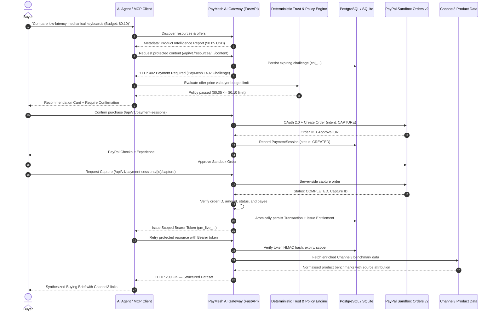

# PayMesh AI — A Trust & Payment Infrastructure for Autonomous AI Commerce

[](https://github.com/rajat552/paypal-hackathon/actions/workflows/ci.yml)
[](LICENSE)
[](https://paypalaihackathon.devpost.com/)
[](docs/decisions/002-l402-protocol-and-security.md)

> **PayPal AI Hackathon 2026 | Master Submission**  
> **PayMesh AI** is a Trust & Payment Infrastructure for Autonomous AI Commerce. It enables content publishers and data providers to monetize APIs and datasets for AI agents via the **PayMesh L402 protocol** and verified **PayPal Sandbox Orders v2 capture**.

---

## 1. Executive Summary & Problem

Content publishers, specialized APIs, and proprietary benchmark providers face an existential dilemma with autonomous AI crawlers: **block them entirely via `robots.txt` / bot walls or have their intellectual property scraped for zero revenue.**

**PayMesh AI transforms this dynamic into permissioned data commerce:**
- **Merchants & Publishers** publish machine-readable data products and dynamic pricing plans (micro-access, hourly passes, pay-per-query).
- **Autonomous AI Agents** discover datasets, receive machine-readable **HTTP 402 Payment Required** challenges (`paymesh-l402`), and submit purchase proposals.
- **Deterministic Trust Engine** validates proposed purchases against spending caps and user permissions without allowing the LLM to make financial judgments.
- **Buyers** approve payment through the **PayPal Sandbox** checkout flow.
- **PayMesh AI Gateway** captures and verifies the PayPal order, records the transaction in an append-only ledger, and issues an expiring, scoped **Bearer token (`pm_live_...`)**.
- **AG Grid Financial Ledger** gives merchants real-time visibility into revenue, conversion rates, and usage telemetry.

---

## 2. End-to-End Architecture & Sequence Flow



---

## 3. Technology Stack & Sponsor Integrations

| Technology / Sponsor | Role & Implementation |
|---|---|
| **PayPal Developer Platform** | **Core Payment Authority**: OAuth 2.0 token caching, Orders v2 creation (`intent: CAPTURE`), buyer approval, server-side capture verification, and idempotent ledger persistence. |
| **Model Context Protocol (MCP)** | Standardized agent interface exposing `paymesh.discover_resources`, `paymesh.get_offer`, `paymesh.request_challenge`, `paymesh.evaluate_purchase`, and `paymesh.fetch_resource`. |
| **Channel3 API** | **Data Provider Integration**: Normalised retail hardware specs, switch profiles, input latency benchmarks, and verifiable source attribution links. |
| **AG Grid** | **Publisher Analytics & Ledger**: High-performance interactive data grid displaying verified PayPal capture records, gross revenue, timestamps, and usage events. |
| **FastAPI & Pydantic v2** | High-performance asynchronous REST API with typed schemas, custom error handlers, and auto-generated OpenAPI / Swagger docs. |
| **SQLAlchemy 2 & Alembic** | Enterprise persistence supporting PostgreSQL (production) and SQLite (zero-config local verification) with complete schema migrations. |
| **React 18 + Tailwind CSS** | Polished FinTech SaaS frontend featuring AI Commerce Agent Workspace, Spending Policy Manager, and AG Grid Financial Ledger. |
| **APIMatic** | Development grounding for PayPal API context, Orders v2 schema verification, and OAuth contract alignment. |
| **Render** | Cloud deployment configuration (`render.yaml`) targeting Dockerized web service and managed PostgreSQL database. |

---

## 4. Key Capabilities of PayMesh AI

1. **PayMesh L402 Protocol**: Standardized machine-readable 402 challenge envelope including challenge ID, resource metadata, server-derived pricing offers, and payment endpoint URLs.
2. **True PayPal Sandbox Payment Lifecycle**: Real OAuth 2.0 client credentials token acquisition, server-calculated purchase units, buyer approval redirect, and server-side capture verification.
3. **Deterministic Trust & Spending Engine**: The LLM is strictly prohibited from authorizing payments or changing amounts. All financial gates evaluate database records deterministically.
4. **Cryptographic Token Separation**: Challenge IDs, PayPal Order IDs, and Bearer Tokens are strictly separate. Only HMAC-SHA256 hashes of `pm_live_...` tokens are stored.
5. **Channel3 Hardware Intelligence**: Delivers normalised retail latency benchmarks, switch profiles, and verifiable product links for the primary research demo.
6. **AG Grid Financial Ledger**: Interactive financial ledger with sorting, filtering, and summary KPIs (Captured Volume, Completed Orders, Active Entitlements, Unique Agents, Conversion Rate).

---

## 5. Quick Start (Local Setup)

### Prerequisites
- Python 3.11+
- Node.js 18+ and npm
- (Optional) Docker for PostgreSQL

### Step 1: Clone and Configure Environment
```bash
git clone https://github.com/rajat552/paypal-hackathon.git
cd paypal-hackathon

# Copy environment template
cp .env.example .env
```

### Step 2: Install Python Dependencies & Run Migrations
```bash
# Install backend requirements
pip install -r requirements.txt

# Run database migrations (defaults to local SQLite database)
python -m alembic upgrade head
```

### Step 3: Build Frontend
```bash
cd frontend
npm install
npm run build
cd ..
```

### Step 4: Start PayMesh AI Gateway
```bash
# Start FastAPI server (serves both React frontend & API on port 8000)
python -m uvicorn backend.app.main:app --host 0.0.0.0 --port 8000
```

Open your browser at **[http://localhost:8000](http://localhost:8000)** to launch the PayMesh AI Portal!

---

## 6. Verification & Automated Tests

PayMesh AI includes automated unit, integration, and security tests:

```bash
# Run complete Pytest test suite (15 tests covering L402, PayPal, Policy, MCP, Analytics)
python -m pytest backend/tests -v
```

### Run End-to-End Smoke Test
Verify the full 7-step sequence against a live server:
```bash
python scripts/smoke_test.py http://localhost:8000
```

---

## 7. Model Context Protocol (MCP) Integration

PayMesh AI exposes a compliant MCP server at `/api/v1/agent/mcp/manifest`. Any MCP-enabled client (e.g., Claude Desktop, custom agents) can discover and call:

- `paymesh.discover_resources`: Search catalog without exposing protected data.
- `paymesh.get_offer`: Fetch server-owned pricing offers.
- `paymesh.request_challenge`: Generate an authoritative PayMesh L402 challenge.
- `paymesh.evaluate_purchase`: Evaluate price against budget limits.
- `paymesh.fetch_resource`: Retrieve content using verified Bearer token (`pm_live_...`).

*(Backward compatibility aliases for `crawlerpal.*` are automatically mapped to `paymesh.*`)*

---

## 8. Devpost Submission Checklist

- [x] **Product Identity**: PayMesh AI — A Trust & Payment Infrastructure for Autonomous AI Commerce.
- [x] **PayPal Integration**: Full PayPal Sandbox Orders v2 lifecycle (OAuth, Create, Approve, Server Capture, Verify).
- [x] **AI Technology**: Autonomous Agent task orchestration, spending policy engine, tool execution, and MCP standard.
- [x] **Sponsor Tracks**: Channel3 (Product Intelligence), AG Grid (Publisher Analytics), APIMatic (Context Plugin), Render (`render.yaml`).
- [x] **Public Repository & Open Source License**: MIT License included with clean-room architecture.
- [x] **Documentation**: Complete setup runbook, Postman collection, OpenAPI Swagger at `/docs`, and decision records (`docs/decisions/`).

---

## 9. License & Attribution

This project is licensed under the [MIT License](LICENSE).  
PayMesh AI builds upon and transforms architectural concepts demonstrated in `positiveblue/CrawlerPal`. All new components (modular backend, database migrations, React frontend, AG Grid analytics, Channel3 client, deterministic trust engine, and MCP engine) are original engineering works for the PayPal AI Hackathon 2026.
