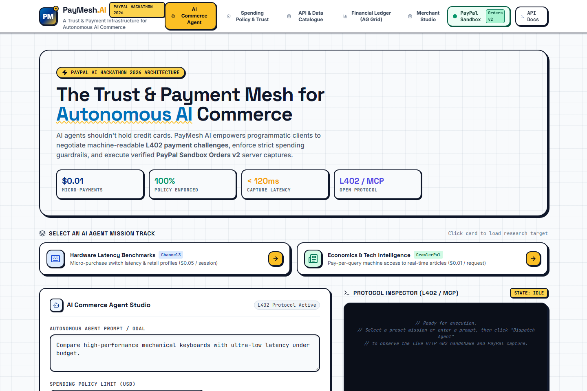
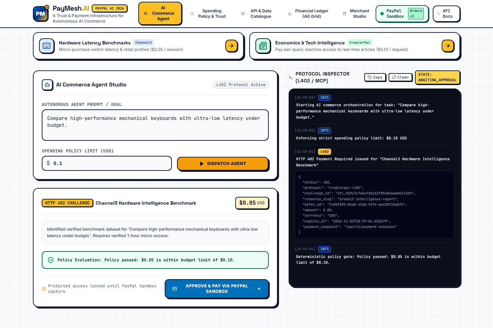
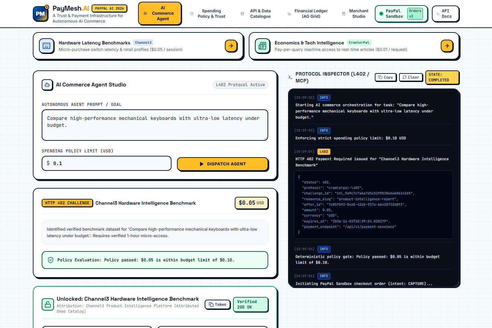
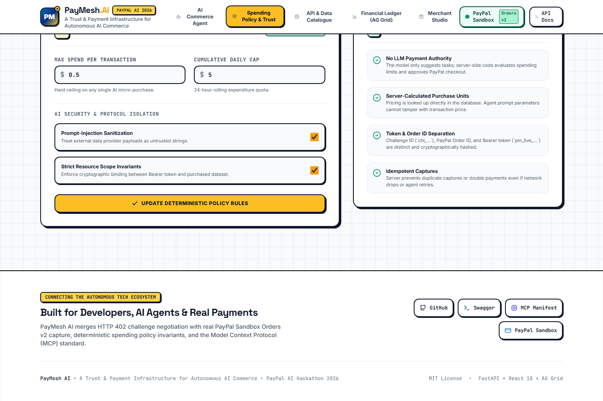
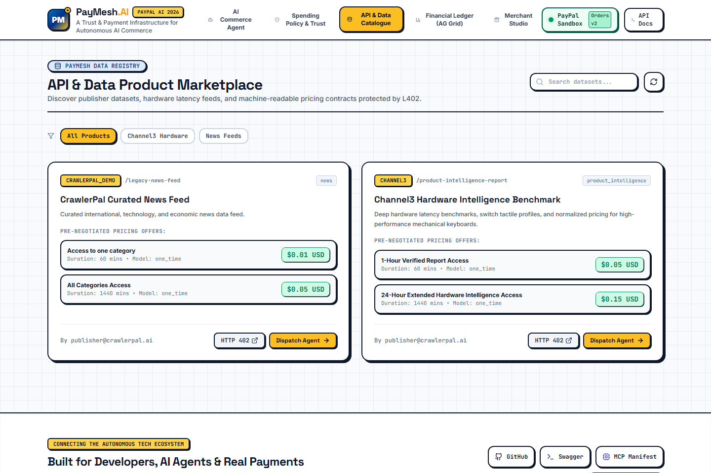
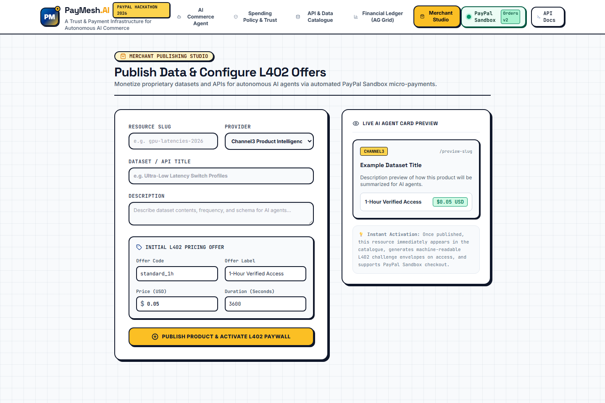
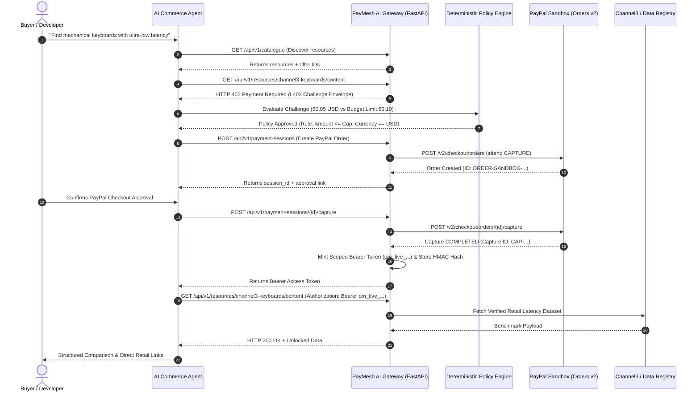

# PayMesh AI

<div align="center">

```
  ██████╗  █████╗ ██╗   ██╗███╗   ███╗███████╗███████╗██╗  ██╗     █████╗ ██╗
  ██╔══██╗██╔══██╗╚██╗ ██╔╝████╗ ████║██╔════╝██╔════╝██║  ██║    ██╔══██╗██║
  ██████╔╝███████║ ╚████╔╝ ██╔████╔██║█████╗  ███████╗███████║    ███████║██║
  ██╔═══╝ ██╔══██║  ╚██╔╝  ██║╚██╔╝██║██╔══╝  ╚════██║██╔══██║    ██╔══██║██║
  ██║     ██║  ██║   ██║   ██║ ╚═╝ ██║███████╗███████║██║  ██║    ██║  ██║██║
  ╚═╝     ╚═╝  ╚═╝   ╚═╝   ╚═╝     ╚═╝╚══════╝╚══════╝╚═╝  ╚═╝    ╚═╝  ╚═╝╚═╝
```

### A Trust & Payment Infrastructure for Autonomous AI Commerce
**Official Submission for the PayPal AI Hackathon 2026**

[](https://www.python.org/)
[](https://fastapi.tiangolo.com)
[](https://developer.paypal.com)
[](https://react.dev)
[](https://www.ag-grid.com)
[](https://L402.org)
[](https://modelcontextprotocol.io/)
[](backend/tests/)
[](LICENSE)

[Visual Showcase](#-dashboard-screenshots--visual-showcase) • [Overview](#-overview) • [Key Features](#-key-features) • [Tech Stack](#-technology-stack) • [Architecture](#-system-architecture) • [Workflows](#-end-to-end-workflows) • [Quick Start](#-installation--setup) • [API Docs](#-api-documentation) • [Testing](#-testing--quality-checks)

</div>

---

## 📸 Dashboard Screenshots & Visual Showcase

PayMesh AI includes a complete, real-time React 18 frontend designed in an authentic **Neo-Tech** aesthetic (inspired by modern developer engineering blueprints and Major League Hacking systems). Every screen below is captured from the running application:

### 1. AI Commerce Agent Studio & Mission Control
The primary command center where developers and autonomous agents formulate goals, enforce spending policies, select mission tracks, and monitor protocol execution in real time.


*Figure 1: The PayMesh AI workspace with mission tracks, research goal input, spending limits, and the live Protocol Inspector terminal.*

---

### 2. Machine-Readable L402 Challenge & PayPal Gateway
When an agent targets protected datasets or APIs, the server issues an authoritative `HTTP 402 Payment Required` challenge. The agent's deterministic policy evaluates the pre-negotiated offer, and triggers the PayPal Sandbox Orders v2 checkout lifecycle.


*Figure 2: Real-time HTTP 402 Challenge card indicating the verified offer, deterministic policy clearance, and the PayPal Sandbox approval action.*

---

### 3. Decrypted Intelligence & Channel3 Product Data
Upon server-side verification of the PayPal capture, a cryptographic scoped Bearer token (`pm_live_...`) is minted, unlocking normalized Channel3 hardware latency benchmarks with direct retailer links.


*Figure 3: Unlocked dataset presentation displaying measured switch latencies, retail pricing, AI market synthesis, and Bearer token copy utility.*

---

### 4. Deterministic Trust & Spending Policy Engine
Guardrails that prevent probabilistic LLM agents from overspending or falling victim to prompt injection. Server-enforced financial limits run independently of the model.


*Figure 4: Spending Policy Engine showing transaction ceilings, 24-hour daily rolling caps, prompt-injection sanitization, and security invariants.*

---

### 5. API & Data Marketplace Catalogue
A machine-readable registry where data providers list intelligence datasets, hardware benchmarks, and pricing offers for programmatic discovery.


*Figure 5: Dataset marketplace featuring live search, pricing tier summaries, raw HTTP 402 endpoint testing, and one-click agent dispatch.*

---

### 6. AG Grid Financial Ledger & KPI Analytics
Enterprise-grade financial analytics tracking captured transaction volume, active entitlements, conversion rates, and immutable PayPal capture IDs.


*Figure 6: Interactive AG Grid financial ledger with sorting, filtering, and real-time PayPal Sandbox capture verification.*

---

### 7. Merchant Publishing Studio
A self-service portal for third-party data providers to register new datasets, set pricing tiers, and generate live AI agent card previews.


*Figure 7: Merchant publishing interface with custom slug generator, provider selector, offer pricing models, and instant live card preview.*

---

## 💡 Overview

### The Problem: AI Agents Shouldn't Hold Credit Cards
The world is transitioning to autonomous software agents capable of conducting research, purchasing data, and provisioning APIs on behalf of users. However:
1. **Agents cannot be trusted with raw financial credentials**: Exposing static API keys or corporate credit cards to an LLM creates catastrophic risks of prompt injection, rogue spending loops, and data exfiltration.
2. **Traditional payment flows require human web browsers**: Redirect loops, cookie-based sessions, and multi-factor captchas break programmatic workflows.
3. **Data providers lack machine paywalls**: Web scrapers bypass monetized paywalls while legitimate bots cannot programmatically pay for single queries.

### The Solution: PayMesh AI
**PayMesh AI** solves this by establishing a **standardized trust and settlement mesh for autonomous AI agents** using the open **L402 protocol** and **PayPal Sandbox Orders v2**:

- **Machine-Readable 402 Paywalls**: Programmatic clients receive structured JSON challenges specifying verified pricing offers, expiration timestamps, and payment endpoints.
- **True PayPal Sandbox Settlement**: Full Orders v2 lifecycle—OAuth 2.0 client authentication, server-calculated purchase units, approval delegation, and server-side capture verification.
- **Deterministic Trust Engine**: The LLM is strictly prohibited from authorizing payments or changing amounts. All financial gates evaluate database records deterministically.
- **Cryptographic Token Separation**: Challenge IDs, PayPal Order IDs, and Bearer Tokens are strictly separated. Only salted HMAC-SHA256 hashes of `pm_live_...` tokens are stored.
- **Model Context Protocol (MCP)**: Native integration enabling Claude Desktop and MCP-compliant autonomous runtimes to discover, negotiate, and unlock paid data natively.

---

## ⚡ Key Features

| Feature | Description | Architecture / Implementation |
| :--- | :--- | :--- |
| **PayMesh L402 Protocol** | Returns standardized `HTTP 402 Payment Required` envelopes with challenge IDs, resource metadata, server-derived pricing offers, and settlement endpoints. | [`backend/app/services/challenge_service.py`](file:///backend/app/services/challenge_service.py) |
| **PayPal Orders v2 Capture** | Genuine PayPal Sandbox integration: OAuth 2.0 token acquisition, purchase unit creation, approval flow, and server-side capture verification. | [`backend/app/services/paypal_gateway.py`](file:///backend/app/services/paypal_gateway.py) |
| **Deterministic Spending Engine** | Enforces hard ceilings per transaction, rolling 24-hour budgets, and currency matching. The LLM cannot alter amounts or bypass rules. | [`backend/app/agent/policy.py`](file:///backend/app/agent/policy.py) |
| **Model Context Protocol (MCP)** | Standardized server exposed at `/api/v1/agent/mcp/manifest` allowing any MCP-compliant agent to discover and purchase datasets programmatically. | [`backend/app/mcp/server.py`](file:///backend/app/mcp/server.py) |
| **Channel3 Intelligence** | Integrated product data provider offering retail hardware switch profiles, latency benchmarks, and verified retailer links. | [`backend/app/services/channel3_client.py`](file:///backend/app/services/channel3_client.py) |
| **AG Grid Financial Ledger** | Enterprise AG Grid Community table providing financial auditing, real-time KPI aggregations, and PayPal capture tracking. | [`frontend/src/components/AnalyticsView.tsx`](file:///frontend/src/components/AnalyticsView.tsx) |
| **Multi-Database Support** | Fully automated database migrations supporting both PostgreSQL (for production) and SQLite (for zero-config local verification). | [`backend/app/db/migrations/`](file:///backend/app/db/migrations/) |

---

## 🛠 Technology Stack

| Layer / Technology | Role in PayMesh AI | Codebase Location |
| :--- | :--- | :--- |
| **Python 3.11+ / FastAPI** | High-performance asynchronous API gateway, L402 paywall middleware, and business logic. | [`backend/app/main.py`](file:///backend/app/main.py), [`backend/app/api/`](file:///backend/app/api/) |
| **PayPal Developer Platform** | Payment settlement gateway using PayPal Orders v2 Sandbox APIs with server-side capture. | [`backend/app/services/paypal_gateway.py`](file:///backend/app/services/paypal_gateway.py) |
| **SQLAlchemy 2.0 (Async)** | Asynchronous ORM handling entities: Resources, Offers, Challenges, Orders, Entitlements, Events. | [`backend/app/models/entities.py`](file:///backend/app/models/entities.py) |
| **Alembic** | Version-controlled database schema migrations with automated upgrade and rollback pipelines. | [`backend/app/db/migrations/`](file:///backend/app/db/migrations/) |
| **Pydantic v2** | Strict schema validation, request/response models, and environment settings parsing. | [`backend/app/schemas/`](file:///backend/app/schemas/), [`backend/app/core/config.py`](file:///backend/app/core/config.py) |
| **React 18 + Vite** | High-speed frontend build serving the interactive AI Commerce Agent Portal. | [`frontend/src/`](file:///frontend/src/) |
| **Tailwind CSS + Neo-Tech** | Modern developer-focused design system with blueprint grids, tactile borders, and hard shadows. | [`frontend/tailwind.config.js`](file:///frontend/tailwind.config.js), [`frontend/src/index.css`](file:///frontend/src/index.css) |
| **AG Grid Community v32** | Interactive financial ledger with sorting, filtering, and live transaction auditing. | [`frontend/src/components/AnalyticsView.tsx`](file:///frontend/src/components/AnalyticsView.tsx) |
| **Model Context Protocol (MCP)** | Anthropic open protocol standard for programmatic LLM tool execution and catalog discovery. | [`backend/app/mcp/server.py`](file:///backend/app/mcp/server.py) |
| **Channel3 API Client** | Third-party sponsor track integration delivering verified retail hardware latency benchmarks. | [`backend/app/services/channel3_client.py`](file:///backend/app/services/channel3_client.py) |
| **Pytest + Playwright** | Comprehensive automated testing: 15 pytest unit/integration tests and browser screenshot automation. | [`backend/tests/`](file:///backend/tests/), [`scripts/capture_screenshots.py`](file:///scripts/capture_screenshots.py) |

---

## 🏛 System Architecture

The following diagram illustrates how the Client, AI Commerce Agent, PayMesh Gateway, PayPal Sandbox, and Data Providers interact:



---

## 🔄 End-to-End Workflows

### 1. Autonomous Agent Data Purchase Workflow
1. **Discovery**: The agent searches the machine-readable marketplace at `/api/v1/catalogue`.
2. **Challenge Generation**: Attempting to fetch protected content without credentials triggers an authoritative `HTTP 402` containing challenge metadata:
   ```json
   {
     "version": "2.0.0",
     "protocol": "paymesh-l402",
     "challenge_id": "chl_75458e2606a8ddf6...",
     "offers": [{ "id": "standard_1h", "amount": 0.05, "currency": "USD" }]
   }
   ```
3. **Deterministic Verification**: The spending policy verifies that the purchase amount is within budget limits. The agent cannot alter the transaction price.
4. **PayPal Order Creation**: The gateway invokes the PayPal Sandbox Orders v2 API with server-calculated purchase units.
5. **Server-Side Capture**: The order is captured against PayPal Sandbox, returning an immutable capture transaction ID.
6. **Token Issuance**: The gateway mints a cryptographic Bearer token (`pm_live_...`), hashes it with HMAC-SHA256, and links it to an entitlement.
7. **Protected Content Retrieval**: The agent exchanges the Bearer token for the decrypted data.

### 2. Merchant Publishing & Monetization Workflow
1. **Registration**: A data merchant registers a new dataset slug, title, and provider via the Merchant Studio or `POST /api/v1/publisher/resources`.
2. **Pricing Offer Definition**: The merchant creates access tiers (e.g., `$0.01` per query or `$0.05` for 1-hour access).
3. **Automated Paywall Activation**: The gateway automatically protects the dataset under `/api/v1/resources/{slug}/content`.
4. **Revenue Audit**: Every programmatic purchase is recorded in the AG Grid financial ledger with its PayPal capture ID and gross revenue.

---

## 📂 Repository Structure

```text
paypal-hackathon/
├── backend/                        # Modern FastAPI backend application
│   ├── app/
│   │   ├── agent/                  # AI agent orchestration, tools, and spending policy
│   │   │   ├── orchestrator.py     # Multi-step discovery, challenge, and capture engine
│   │   │   ├── policy.py           # Deterministic spending limit guardrails
│   │   │   └── tools.py            # Agent tool definitions (catalogue, challenge, payment)
│   │   ├── api/v1/routes/          # REST API endpoints (Catalogue, Payments, MCP, Publisher)
│   │   ├── core/                   # Application config, security, logging, exceptions
│   │   ├── db/                     # SQLAlchemy async engine, base model, migrations
│   │   │   └── migrations/         # Alembic database schema migration versions
│   │   ├── mcp/                    # Anthropic Model Context Protocol (MCP) server
│   │   ├── models/                 # Database entity models (Resource, Offer, Entitlement, etc.)
│   │   ├── schemas/                # Pydantic v2 validation models
│   │   ├── services/               # PayPal Orders v2 gateway, L402 challenge service, Channel3
│   │   ├── templates/              # Fallback HTML portal templates
│   │   └── main.py                 # FastAPI application root, lifespan, and CORS middleware
│   ├── tests/                      # Automated unit and integration test suite
│   │   ├── conftest.py             # Asynchronous test client and database fixtures
│   │   ├── integration/            # API, L402, PayPal, and MCP integration tests
│   │   └── unit/                   # Policy engine, token hashing, and config unit tests
│   ├── Dockerfile                  # Container definition for web service
│   └── requirements.txt            # Python dependencies
├── client/                         # Command-line interface (CLI) programmatic client
│   └── main.py                     # CLI tool for automated bot purchases
├── docs/                           # Architecture decision records and visual assets
│   ├── assets/screenshots/         # Genuine screenshots captured via Playwright
│   └── decisions/                  # ADR 001 (Stack), ADR 002 (L402), ADR 003 (PayPal)
├── frontend/                       # Modern React 18 + Tailwind CSS + AG Grid frontend
│   ├── src/
│   │   ├── components/             # Workspace, PolicyManager, CatalogueView, AnalyticsView
│   │   ├── App.tsx                 # Main application shell with blueprint grid and footer
│   │   ├── index.css               # Neo-tech styling utilities, blueprint grid, and AG Grid CSS
│   │   └── main.tsx                # React DOM root entry point
│   ├── package.json                # Frontend package dependencies
│   ├── tailwind.config.js          # Neo-brutalist shadow tokens, palette, and fonts
│   └── vite.config.ts              # Vite build configuration and backend proxy
├── postman/                        # Postman collection for manual API testing
├── scripts/                        # Automated smoke test and screenshot capture scripts
│   ├── capture_screenshots.py      # Automated Playwright UI screenshot runner
│   └── smoke_test.py               # 7-step end-to-end integration smoke test
├── .env.example                    # Environment configuration template
├── alembic.ini                     # Alembic migration configuration
├── docker-compose.yml              # Local multi-container development environment
├── render.yaml                     # Production cloud deployment configuration
└── workflows.md                    # Master development specification
```

---

## 📋 Prerequisites

- **Python**: Version `3.11` or higher (`3.11`, `3.12`, or `3.13` supported).
- **Node.js**: Version `18.x` or higher (with `npm 9+`).
- **PayPal Developer Account**: Sandbox Client ID and Secret from the [PayPal Developer Dashboard](https://developer.paypal.com).
- *(Optional)* **Docker & Docker Compose**: For containerized deployment.

---

## 🚀 Installation & Setup

### 1. Clone the Repository
```bash
git clone https://github.com/rajat552/paypal-hackathon.git
cd paypal-hackathon
```

### 2. Configure Environment Variables
Copy the template and configure your credentials:
```bash
cp .env.example .env
```
*(See [Environment Variables](#-environment-variables) for detailed descriptions).*

### 3. Install Backend Dependencies & Apply Database Migrations
```bash
# Install Python packages
pip install -r requirements.txt

# Run Alembic schema migrations (creates SQLite tables automatically)
python -m alembic upgrade head
```

### 4. Build the Frontend
```bash
cd frontend
npm install
npm run build
cd ..
```

### 5. Start the PayMesh AI Server
Launch the unified FastAPI server (which serves both the API endpoints and the built React frontend on port `8000`):
```bash
python -m uvicorn backend.app.main:app --host 0.0.0.0 --port 8000
```

Open your browser and navigate to:
👉 **[http://localhost:8000](http://localhost:8000)**

---

## 🔐 Environment Variables

The application is configured through environment variables defined in `.env`:

| Variable Name | Purpose | Required? | Default / Example Value |
| :--- | :--- | :---: | :--- |
| `ENVIRONMENT` | Environment mode (`development`, `staging`, `production`) | No | `development` |
| `DATABASE_URL` | SQLAlchemy connection string (SQLite or PostgreSQL) | Yes | `sqlite+aiosqlite:///./paymesh.db` |
| `PAYPAL_MODE` | PayPal API environment (`sandbox` or `live`) | Yes | `sandbox` |
| `PAYPAL_CLIENT_ID` | PayPal REST API client identifier | Yes | `A...` *(from PayPal Developer Portal)* |
| `PAYPAL_CLIENT_SECRET` | PayPal REST API secret key | Yes | `E...` *(from PayPal Developer Portal)* |
| `SECRET_KEY` | HMAC secret for hashing tokens and challenges | Yes | `replace-with-a-secure-random-key` |
| `AGENT_DEFAULT_BUDGET_USD` | Default spending budget for AI agent missions | No | `0.10` |
| `AGENT_MAX_PER_TX_USD` | Maximum permitted spend on a single transaction | No | `0.50` |
| `AGENT_DAILY_CAP_USD` | 24-hour rolling expenditure limit | No | `5.00` |
| `CHANNEL3_API_KEY` | Optional Channel3 product intelligence API key | No | `ch3_sandbox_demo_key` |

> **Security Note:** Never commit your actual `.env` file containing live credentials. The repository `.gitignore` strictly protects `.env`.

---

## 🖥 Usage Guide

### 1. Running an Autonomous Commerce Mission
1. Open the portal at `http://localhost:8000`.
2. Click on the **Channel3 Hardware Latency** preset or enter a custom prompt (e.g., *"Compare ultra-low latency mechanical switches under budget"*).
3. Set your **Spending Policy Limit** (e.g., `$0.10 USD`).
4. Click **"Dispatch Agent"**.
5. Observe the live **Protocol Inspector** log:
   - The agent discovers matching datasets.
   - The server issues an `HTTP 402` challenge.
   - The deterministic policy verifies that the `$0.05` price is within the `$0.10` limit.
6. Click **"Approve & Pay via PayPal Sandbox"**.
7. The gateway captures the PayPal order and displays the unlocked retail latency dataset with direct product links!

### 2. Testing via CLI Client
You can also execute programmatic purchases using the Python CLI:
```bash
# Attempt unauthenticated request (returns HTTP 402 Challenge)
python client/main.py

# Execute full automated L402 payment flow via PayPal Sandbox
python client/main.py --pay

# Fetch protected content with the issued Bearer token
python client/main.py --with-auth <bearer-token>
```

---

## 📡 API Documentation

Interactive Swagger OpenAPI documentation is available at:
👉 **[http://localhost:8000/docs](http://localhost:8000/docs)**

### Core API Endpoints

| Method | Endpoint | Description | Auth Required |
| :---: | :--- | :--- | :---: |
| `GET` | `/health` | Application health check and database connectivity | Public |
| `GET` | `/api/v1/catalogue` | Discover datasets, providers, and pricing offers | Public |
| `GET` | `/api/v1/resources/{slug}/content` | Fetch protected content (returns `402` without token) | Bearer Token |
| `POST` | `/api/v1/payment-sessions` | Create a PayPal Sandbox Orders v2 checkout session | Public |
| `POST` | `/api/v1/payment-sessions/{id}/capture` | Server-side capture and verification of PayPal Order | Public |
| `POST` | `/api/v1/agent/runs` | Multi-step agent discovery, challenge, and policy execution | Public |
| `GET` | `/api/v1/agent/mcp/manifest` | Anthropic Model Context Protocol (MCP) server manifest | Public |
| `POST` | `/api/v1/publisher/resources` | Register a new dataset and provider | Public |
| `POST` | `/api/v1/publisher/resources/{id}/offers` | Create pricing offers for a dataset | Public |
| `GET` | `/api/v1/publisher/analytics/summary` | Real-time KPI summaries (revenue, orders, conversion) | Public |
| `GET` | `/api/v1/publisher/analytics/transactions` | Detailed ledger of all captured PayPal transactions | Public |

---

## 🧪 Testing & Quality Checks

PayMesh AI includes automated unit, integration, and end-to-end tests:

### 1. Run Complete Pytest Suite
Executes 15 comprehensive tests covering config validation, token hashing, deterministic policy enforcement, HTTP 402 challenges, PayPal Order captures, and MCP execution:
```bash
python -m pytest backend/tests -v
```

**Expected Output:**
```text
backend/tests/integration/test_api_endpoints.py::test_health_endpoint PASSED
backend/tests/integration/test_api_endpoints.py::test_catalogue_endpoint PASSED
backend/tests/integration/test_api_endpoints.py::test_protected_resource_returns_402_challenge PASSED
backend/tests/integration/test_api_endpoints.py::test_full_payment_capture_and_retrieval_flow PASSED
backend/tests/integration/test_api_endpoints.py::test_agent_run_orchestration PASSED
backend/tests/integration/test_api_endpoints.py::test_mcp_manifest_and_tool_execution PASSED
backend/tests/integration/test_api_endpoints.py::test_legacy_bot_l402_and_payment_flow PASSED
backend/tests/unit/test_config_and_security.py::test_settings_properties PASSED
backend/tests/unit/test_config_and_security.py::test_token_hashing_and_verification PASSED
backend/tests/unit/test_config_and_security.py::test_challenge_id_format PASSED
backend/tests/unit/test_config_and_security.py::test_password_hashing PASSED
backend/tests/unit/test_policy.py::test_policy_within_budget PASSED
backend/tests/unit/test_policy.py::test_policy_exceeds_budget PASSED
backend/tests/unit/test_policy.py::test_policy_currency_mismatch PASSED
backend/tests/unit/test_policy.py::test_policy_inactive_offer PASSED
============================= 15 passed in 0.86s =============================
```

### 2. Run End-to-End Smoke Test
Tests all 7 end-to-end integration steps against a live server:
```bash
python scripts/smoke_test.py http://localhost:8000
```

---

## 🔧 Troubleshooting

| Symptom | Cause | Solution |
| :--- | :--- | :--- |
| **`HTTP 500: Database table missing`** | Alembic migrations have not been applied. | Run `python -m alembic upgrade head` to initialize tables. |
| **`PayPal Authentication Failed`** | Invalid Sandbox credentials in `.env`. | Verify `PAYPAL_CLIENT_ID` and `PAYPAL_CLIENT_SECRET` in `.env`. |
| **`Frontend shows blank page`** | Frontend assets not built or server pointing to wrong directory. | Run `cd frontend && npm run build` and ensure `backend/app/main.py` is serving `frontend/dist`. |
| **`Port 8000 already in use`** | A lingering server process is bound to port 8000. | Terminate the existing process or run Uvicorn on another port: `--port 8080`. |
| **`Policy Rejected: Exceeds Budget`** | Requested offer amount exceeds the policy ceiling. | Increase the budget limit in the UI or adjust `AGENT_MAX_PER_TX_USD` in `.env`. |

---

## ☁️ Deployment

PayMesh AI includes an official Render blueprint (`render.yaml`) for one-click deployment:

```yaml
services:
  - type: web
    name: paymesh-ai
    env: docker
    dockerfilePath: backend/Dockerfile
    plan: starter
    envVars:
      - key: ENVIRONMENT
        value: production
      - key: DATABASE_URL
        fromDatabase:
          name: paymesh-db
          property: connectionString
      - key: PAYPAL_MODE
        value: sandbox

databases:
  - name: paymesh-db
    databaseName: paymesh
    user: paymesh_user
    plan: starter
```

---

## 🗺 Project Status & Roadmap

- [x] **Phase 1**: Architecture & schema design (SQLAlchemy 2.0, Alembic, SQLite, PostgreSQL).
- [x] **Phase 2**: Core L402 machine-readable challenge envelope engine.
- [x] **Phase 3**: PayPal Orders v2 Sandbox OAuth and server-side capture verification.
- [x] **Phase 4**: Deterministic trust & spending policy guardrails.
- [x] **Phase 5**: Model Context Protocol (MCP) tool server at `/api/v1/agent/mcp/manifest`.
- [x] **Phase 6**: Channel3 Product Intelligence client integration.
- [x] **Phase 7**: AG Grid financial ledger and analytics KPIs.
- [x] **Phase 8**: Major League Hacking (MLH) neo-tech UI overhaul.
- [ ] **Roadmap Q2 2026**: Multi-currency auto-conversion via PayPal FX APIs.
- [ ] **Roadmap Q3 2026**: Zero-Knowledge proof of funds for autonomous multi-agent swarms.

---

## 📄 License & Attribution

This project is licensed under the **[MIT License](LICENSE)**.

### Acknowledgements & Sponsor Integrations
- **PayPal Developer Platform**: For PayPal Orders v2 Sandbox payment rails.
- **Channel3**: For verified hardware latency benchmarks and retail product links.
- **AG Grid**: For enterprise-grade financial table auditing and analytics.
- **Anthropic**: For the Model Context Protocol (MCP) open standard.
- **Positiveblue / CrawlerPal**: Early conceptual inspirations for HTTP 402 experiments. All production modules, Alembic migrations, L402 challenge mechanisms, deterministic trust engines, React frontend, and MCP implementations are original works for the PayPal AI Hackathon 2026.
