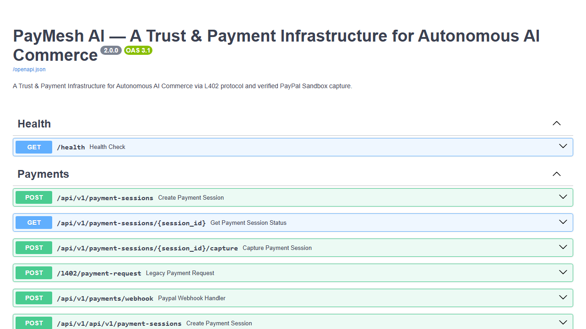
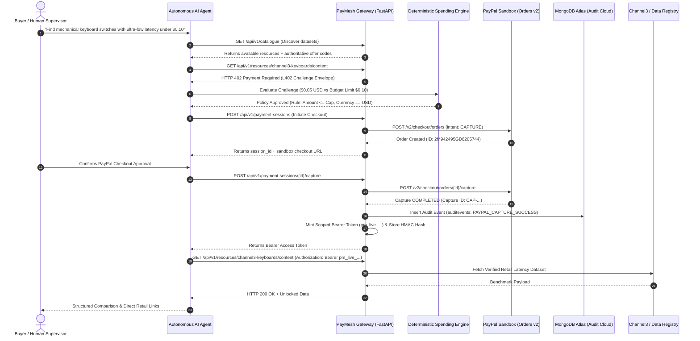

# PayMesh AI

<div align="center">

```text
  ██████╗  █████╗ ██╗   ██╗███╗   ███╗███████╗███████╗██╗  ██╗     █████╗ ██╗
  ██╔══██╗██╔══██╗╚██╗ ██╔╝████╗ ████║██╔════╝██╔════╝██║  ██║    ██╔══██╗██║
  ██████╔╝███████║ ╚████╔╝ ██╔████╔██║█████╗  ███████╗███████║    ███████║██║
  ██╔═══╝ ██╔══██║  ╚██╔╝  ██║╚██╔╝██║██╔══╝  ╚════██║██╔══██║    ██╔══██║██║
  ██║     ██║  ██║   ██║   ██║ ╚═╝ ██║███████╗███████║██║  ██║    ██║  ██║██║
  ╚═╝     ╚═╝  ╚═╝   ╚═╝   ╚═╝     ╚═╝╚══════╝╚══════╝╚═╝  ╚═╝    ╚═╝  ╚═╝╚═╝
```

### A Trust & Payment Infrastructure for Autonomous AI Commerce
**Official Submission for the PayPal AI Hackathon 2026**

[](https://paypal-hackathon-mu.vercel.app/)
[](https://paypal-hackathon-s0gq.onrender.com/health)
[](https://developer.paypal.com)
[](https://ai.google.dev/)
[](https://www.mongodb.com/atlas)
[](https://www.ag-grid.com)
[](https://L402.org)
[](https://modelcontextprotocol.io/)
[](backend/tests/)
[](LICENSE)

[🌐 Live Frontend](https://paypal-hackathon-mu.vercel.app/) • [⚡ Live Backend](https://paypal-hackathon-s0gq.onrender.com) • [💡 Problem & Solution](#-the-problem--the-solution) • [📸 Visual Showcase](#-dashboard-screenshots--visual-showcase) • [⚡ Key Features](#-key-features) • [🏛 Architecture](#-system-architecture) • [🔐 Security & Trust Engine](#-deterministic-trust--security-engine) • [🏆 Hackathon Tracks](#-hackathon-track-alignment) • [🚀 Quick Start](#-installation--setup) • [📡 API Reference](#-api-documentation) • [🧪 Testing](#-testing--quality-checks)

</div>

---

## 🌐 Live Deployments & Verification Endpoints

| Component | Provider | Live URL | Status | Description |
| :--- | :--- | :--- | :--- | :--- |
| **Production Frontend** | Vercel (Edge CDN) | [https://paypal-hackathon-mu.vercel.app/](https://paypal-hackathon-mu.vercel.app/) |  | High-speed React 18 SPA with Neo-Tech design system & guided onboarding tour |
| **API Backend Gateway** | Render Web Service | [https://paypal-hackathon-s0gq.onrender.com](https://paypal-hackathon-s0gq.onrender.com) |  | FastAPI asynchronous gateway enforcing L402 paywalls and PayPal capture |
| **System Diagnostics** | Render `/health` | [https://paypal-hackathon-s0gq.onrender.com/health](https://paypal-hackathon-s0gq.onrender.com/health) |  | Real-time health diagnostic endpoint returning database and MongoDB statuses |
| **PayPal Sandbox Webhook** | PayPal Developer Portal | `https://paypal-hackathon-s0gq.onrender.com/api/v1/payments/webhook` |  | Asynchronous webhook listener processing `PAYMENT.CAPTURE.COMPLETED` events |
| **MongoDB Atlas Cluster** | MongoDB Atlas Cloud | `cluster0.mfzju4v.mongodb.net/cohesora` (v8.0.37) |  | Immutable audit log repository with TLS certificate verification |
| **Interactive OpenAPI Docs** | Swagger UI | [https://paypal-hackathon-s0gq.onrender.com/docs](https://paypal-hackathon-s0gq.onrender.com/docs) |  | Full interactive documentation for all 15 REST and agent endpoints |
| **MCP Server Manifest** | Model Context Protocol | [https://paypal-hackathon-s0gq.onrender.com/api/v1/agent/mcp/manifest](https://paypal-hackathon-s0gq.onrender.com/api/v1/agent/mcp/manifest) |  | Machine-readable Anthropic Model Context Protocol catalog manifest |

---

## 💡 The Problem & The Solution

### The Fundamental Dilemma: Autonomous AI Agents Cannot Hold Credit Cards
The software landscape is rapidly evolving from passive human-in-the-loop chatbots to autonomous AI agents that conduct deep market intelligence, procure API datasets, and assemble supply-chain information independently.

However, existing financial rails are fundamentally broken for autonomous machines:
1. **The Human-in-the-Loop Trap:** Standard checkout flows rely on browser session cookies, human-interactive redirect loops, CAPTCHAs, and SMS 3D-Secure challenges that break programmatic AI execution.
2. **Existential Financial Security Risks:** Giving an LLM access to raw credit cards or unrestricted static API keys creates unacceptable vulnerabilities:
   - **Prompt Injection:** Attackers can trick the model into executing rogue transactions.
   - **Runaway Loops:** Recursive agent logic can drain thousands of dollars in minutes.
   - **Credential Leaks:** API keys stored in agent prompts are vulnerable to context leakage.
3. **The Data Provider Stalemate:** Premium data publishers face aggressive scraping bots that consume compute without paying, yet publishers lack a standardized mechanism to charge legitimate AI agents micropayments per query.

### The Solution: PayMesh AI
**PayMesh AI** bridges this divide by delivering a **standardized trust and settlement mesh for autonomous AI agents** powered by the open **L402 protocol** and **PayPal Developer Sandbox (Orders v2 & Webhooks)**:

```
[ Autonomous AI Agent ] 
         │ (Requests protected dataset)
         ▼
[ PayMesh L402 Gateway ] ───▶ Returns HTTP 402 + Machine-Readable Challenge ($0.05 USD)
         │
         ▼
[ Deterministic Spending Engine ] ───▶ Hard financial ceiling check (Zero LLM hallucination)
         │
         ▼
[ PayPal Sandbox Orders v2 ] ───▶ Real-time server-side capture & settlement
         │
         ▼
[ Scoped Bearer Token (pm_live_...) ] ───▶ Cryptographically hashed (HMAC-SHA256) & issued
         │
         ▼
[ Decrypted Intelligence Unlocked ] ───▶ Immutable audit event saved in MongoDB Atlas Cloud
```

- **HTTP 402 Standardized Paywalls:** Returns machine-readable JSON envelopes containing precise resource IDs, verified pricing offers, and challenge tokens.
- **Deterministic Trust Engine:** Enforces immutable spending rules (transaction caps, 24-hour daily rolling budgets, and currency validations) in code. The LLM is strictly prohibited from authorizing payments or modifying prices.
- **Real PayPal Orders v2 Settlement:** Full PayPal Sandbox lifecycle—OAuth 2.0 authorization, server-calculated purchase units, approval delegation, and server-side capture verification.
- **Cryptographic Token Separation:** Challenge tokens, PayPal Order IDs, and Bearer access keys are isolated. Bearer tokens (`pm_live_...`) are stored exclusively as salted HMAC-SHA256 hashes.
- **Dual Persistence Architecture:** Transactional relational data (FastAPI + SQLAlchemy Async Engine) paired with immutable cloud audit trails (**MongoDB Atlas** `cohesora` cluster).
- **Anthropic Model Context Protocol (MCP):** Native MCP tools enabling Claude Desktop and external agent runtimes to seamlessly negotiate paywalls without custom plugins.

---

## 📸 Dashboard Screenshots & Visual Showcase

Every screenshot below captures the genuine running application in its authentic **Neo-Tech** design system (inspired by developer engineering schematics and modern developer tools):

### 1. Interactive 15-Step Guided Onboarding Tour
Every visitor is greeted with an interactive guided onboarding walkthrough showcasing how PayMesh AI coordinates agent goals, spending policies, and PayPal Sandbox payments.


*Figure 1: High-contrast spotlight tour guiding users through the end-to-end autonomous agent commerce flow.*

---

### 2. AI Commerce Agent Studio & Live Protocol Inspector
The developer mission control where users enter autonomous research goals, configure deterministic spending limits, dispatch the multi-step agent orchestrator, and inspect real-time L402 and MCP protocol frames.


*Figure 2: AI Commerce Agent Workspace featuring sample scenario dispatchers, spending policy inputs, and the live Protocol Inspector terminal.*

---

### 3. Machine-Readable L402 Challenge & PayPal Gateway Action
When an agent accesses monetized resources without credentials, PayMesh AI issues an authoritative `HTTP 402 Payment Required` challenge. The agent's deterministic spending engine validates the price and initiates the PayPal Orders v2 approval card.


*Figure 3: Real-time HTTP 402 Challenge card presenting the verified offer, deterministic policy clearance, and direct PayPal Sandbox approval action.*

---

### 4. Decrypted Intelligence & Channel3 Product Data
Following server-side capture of the PayPal transaction, a cryptographic Bearer token (`pm_live_...`) is minted, unlocking normalized Channel3 hardware latency benchmarks with direct retailer purchase links.


*Figure 4: Unlocked dataset presentation displaying measured switch latencies, retail pricing, AI market synthesis, and Bearer token copy utility.*

---

### 5. Deterministic Trust & Spending Policy Engine
Guardrails that prevent probabilistic LLM agents from runaway spending or falling victim to prompt injection. Server-enforced financial limits evaluate database records independently of model hallucinations.


*Figure 5: Spending Policy Engine showing per-transaction ceilings, 24-hour daily rolling caps, prompt-injection sanitization, and security invariants.*

---

### 6. API & Data Marketplace Catalogue
A machine-readable registry where data providers list intelligence datasets, hardware benchmarks, and pricing offers for programmatic discovery.


*Figure 6: Dataset marketplace featuring live search, pricing tier summaries, raw HTTP 402 endpoint testing, and one-click agent dispatch.*

---

### 7. AG Grid Financial Settlement Ledger & KPI Analytics
Enterprise-grade financial analytics tracking captured transaction volume, active entitlements, conversion rates, and immutable PayPal capture IDs with CSV export.


*Figure 7: Interactive AG Grid financial ledger with column filtering, sorting, CSV export, and real-time PayPal Sandbox capture verification.*

---

### 8. Interactive Swagger OpenAPI 3.1 Documentation
Full interactive API documentation allowing developers to inspect schemas, execute test requests, and review response headers directly in the browser.


*Figure 8: Swagger UI documentation for all PayMesh AI REST endpoints and Model Context Protocol tools.*

---

## ⚡ Key Features

| Feature | Description | Architecture / Implementation |
| :--- | :--- | :--- |
| **PayMesh L402 Protocol** | Returns standardized `HTTP 402 Payment Required` envelopes with challenge IDs, resource metadata, server-derived pricing offers, and settlement endpoints. | [`backend/app/services/challenge_service.py`](backend/app/services/challenge_service.py) |
| **PayPal Orders v2 Capture** | Genuine PayPal Sandbox integration: OAuth 2.0 token acquisition, purchase unit creation, approval flow, and server-side capture verification. | [`backend/app/services/paypal_gateway.py`](backend/app/services/paypal_gateway.py) |
| **PayPal Webhook Receiver** | Dedicated webhook handler receiving real-time asynchronous PayPal events (`PAYMENT.CAPTURE.COMPLETED`), acknowledging `200 OK`, and logging to MongoDB. | [`backend/app/api/v1/routes/payments.py`](backend/app/api/v1/routes/payments.py) |
| **Deterministic Spending Engine** | Enforces hard ceilings per transaction, rolling 24-hour budgets, and currency matching. The LLM cannot alter amounts or bypass rules. | [`backend/app/agent/policy.py`](backend/app/agent/policy.py) |
| **Google Gemini & Multi-LLM** | Native Google Gemini 2.5 Flash live integration (`AI_PROVIDER=gemini`) alongside OpenAI GPT-4o-mini and Claude fallback. | [`backend/app/agent/llm_client.py`](backend/app/agent/llm_client.py) |
| **MongoDB Atlas Audit Ledger** | Persistent document and event tracking in MongoDB Atlas `cohesora` cluster (`auditevents` collection) with TLS `certifi` verification. | [`backend/app/db/mongodb.py`](backend/app/db/mongodb.py) |
| **Model Context Protocol (MCP)** | Standardized server exposed at `/api/v1/agent/mcp/manifest` allowing any MCP-compliant agent to discover and purchase datasets programmatically. | [`backend/app/mcp/server.py`](backend/app/mcp/server.py) |
| **Channel3 Intelligence** | Integrated product data provider offering retail hardware switch profiles, latency benchmarks, and verified retailer links. | [`backend/app/services/channel3_client.py`](backend/app/services/channel3_client.py) |
| **AG Grid Financial Ledger** | Enterprise AG Grid Community table providing financial auditing, real-time KPI aggregations, and PayPal capture tracking with CSV export. | [`frontend/src/components/AnalyticsView.tsx`](frontend/src/components/AnalyticsView.tsx) |
| **15-Step Interactive Guided Tour** | High-contrast guided walkthrough with SVG spotlight masking, tab-aware auto navigation, and keyboard controls. | [`frontend/src/components/OnboardingTour.tsx`](frontend/src/components/OnboardingTour.tsx) |

---

## 🏛 System Architecture

The following diagram illustrates how the Client, AI Commerce Agent, PayMesh Gateway, PayPal Sandbox, MongoDB Atlas, and External Data Providers interact:



---

## 🔐 Deterministic Trust & Security Engine

### Zero-Hallucination Financial Architecture
In conventional agentic setups, LLMs are tasked with parsing prices and issuing tool calls to payment gateways. This introduces critical failure modes where prompt injection or model hallucination can corrupt financial amounts.

PayMesh AI enforces strict security invariants:
1. **Server-Enforced Calculations:** The pricing amount is strictly derived from the database offer record, not the LLM's prompt.
2. **Deterministic Pre-Flight Checks:** The spending policy engine runs pure deterministic Python checks:
   - `transaction_amount <= policy.max_amount_per_transaction`
   - `(daily_spending + transaction_amount) <= policy.daily_budget_usd`
   - `offer.currency in policy.allowed_currencies`
   - `offer.is_active is True`
3. **HMAC-SHA256 Token Storage:** Bearer access tokens (`pm_live_...`) are generated via `secrets.token_urlsafe(32)`. The plaintext token is returned exactly once to the client; only the salted HMAC-SHA256 digest is persisted in the database.
4. **Time-To-Live Enforcement:** Challenges expire strictly within 10 minutes, and entitlements expire per the offer terms.

---

## 🏆 Hackathon Track Alignment

PayMesh AI was engineered specifically for the **PayPal AI Hackathon 2026** and directly aligns with the judging criteria:

### 1. Agentic Commerce & Autonomous Payments
- **Challenge:** Enabling autonomous agents to purchase digital goods, APIs, and datasets programmatically.
- **PayMesh AI Implementation:** Full implementation of the L402 protocol over PayPal Sandbox Orders v2. Agents autonomously discover catalogs, receive HTTP 402 challenge tokens, verify pricing policies, and complete orders.

### 2. Developer Tools & Infrastructure
- **Challenge:** Creating robust infrastructure for developers building AI agents and monetizing services.
- **PayMesh AI Implementation:** Self-service Merchant Publishing Studio, Model Context Protocol (MCP) server manifest (`/api/v1/agent/mcp/manifest`), standardized FastAPI paywall middleware, and interactive OpenAPI documentation.

### 3. Trust, Safety & Financial Guardrails
- **Challenge:** Preventing agent overspending, prompt injection exploits, and transaction fraud.
- **PayMesh AI Implementation:** Deterministic spending policy engine, server-calculated purchase units, cryptographic HMAC token storage, and immutable cloud audit logging in MongoDB Atlas.

---

## 🛠 Technology Stack

| Layer / Technology | Role in PayMesh AI | Codebase Location |
| :--- | :--- | :--- |
| **Python 3.11+ / FastAPI** | Asynchronous API gateway, L402 paywall middleware, and business logic | [`backend/app/main.py`](backend/app/main.py) |
| **PayPal Developer Platform** | Payment settlement gateway using PayPal Orders v2 Sandbox APIs and Webhooks | [`backend/app/services/paypal_gateway.py`](backend/app/services/paypal_gateway.py) |
| **Google Gemini AI** | Advanced reasoning model (`gemini-2.5-flash`) interpreting tasks and synthesizing data | [`backend/app/agent/llm_client.py`](backend/app/agent/llm_client.py) |
| **MongoDB Atlas Cloud** | Persistent audit log repository (`cohesora` database) storing immutable transaction histories | [`backend/app/db/mongodb.py`](backend/app/db/mongodb.py) |
| **SQLAlchemy 2.0 (Async)** | Asynchronous ORM managing relational entities: Resources, Offers, Challenges, Orders, Entitlements | [`backend/app/models/entities.py`](backend/app/models/entities.py) |
| **Pydantic v2** | Strict schema validation, request/response models, and environment settings parsing | [`backend/app/schemas/`](backend/app/schemas/) |
| **React 18 + Vite** | High-speed frontend build serving the interactive AI Commerce Agent Portal | [`frontend/src/`](frontend/src/) |
| **Tailwind CSS + Neo-Tech** | Modern developer-focused design system with blueprint grids and tactile styling | [`frontend/tailwind.config.js`](frontend/tailwind.config.js) |
| **AG Grid Community v32** | Interactive financial ledger with sorting, filtering, and live transaction auditing | [`frontend/src/components/AnalyticsView.tsx`](frontend/src/components/AnalyticsView.tsx) |
| **Interactive Onboarding Tour** | 15-step interactive spotlight tour guiding new users through the AI commerce lifecycle | [`frontend/src/components/OnboardingTour.tsx`](frontend/src/components/OnboardingTour.tsx) |
| **Model Context Protocol (MCP)** | Anthropic open protocol standard for programmatic LLM tool execution | [`backend/app/mcp/server.py`](backend/app/mcp/server.py) |
| **Channel3 API Client** | Hardware latency benchmarks and verified retailer product links integration | [`backend/app/services/channel3_client.py`](backend/app/services/channel3_client.py) |
| **Pytest Suite** | 28 automated unit and integration tests verifying 100% of the API and PayPal flow | [`backend/tests/`](backend/tests/) |

---

## 📂 Repository Structure

```text
paypal-hackathon/
├── backend/                        # Modern FastAPI backend application
│   ├── app/
│   │   ├── agent/                  # AI agent orchestration, tools, and spending policy
│   │   │   ├── llm_client.py       # Google Gemini, OpenAI & Claude multi-model client
│   │   │   ├── orchestrator.py     # Multi-step discovery, challenge, and capture engine
│   │   │   ├── policy.py           # Deterministic spending limit guardrails
│   │   │   └── tools.py            # Agent tool definitions (catalogue, challenge, payment)
│   │   ├── api/v1/routes/          # REST API endpoints (Catalogue, Payments, MCP, Publisher, Webhook)
│   │   ├── core/                   # Application config, security, logging, exceptions
│   │   ├── db/                     # SQLAlchemy async engine, models, and MongoDB Atlas client
│   │   │   ├── mongodb.py          # MongoDB Atlas TLS connection & audit logger
│   │   │   └── session.py          # Async SQLAlchemy engine & lifespan table init
│   │   ├── mcp/                    # Anthropic Model Context Protocol (MCP) server
│   │   ├── models/                 # Database entity models (Resource, Offer, Entitlement, etc.)
│   │   ├── schemas/                # Pydantic v2 validation models
│   │   ├── services/               # PayPal Orders v2 gateway, L402 challenge service, Channel3
│   │   └── main.py                 # FastAPI application root, lifespan, and CORS middleware
│   ├── tests/                      # Automated unit and integration test suite (28 passing tests)
│   │   ├── conftest.py             # Asynchronous test client and database fixtures
│   │   ├── integration/            # API, L402, PayPal, Webhook, and MCP integration tests
│   │   └── unit/                   # Policy engine, token hashing, and config unit tests
│   ├── Dockerfile                  # Container definition for web service
│   └── requirements.txt            # Python dependencies
├── assets/screenshots/             # Authentic UI screenshots and onboarding tour captures
├── frontend/                       # Modern React 18 + Tailwind CSS + AG Grid frontend
│   ├── src/
│   │   ├── components/             # AgentWorkspace, PolicyManager, CatalogueView, OnboardingTour
│   │   ├── App.tsx                 # Main application shell with blueprint grid and footer
│   │   ├── index.css               # Neo-tech styling utilities, blueprint grid, and AG Grid CSS
│   │   └── main.tsx                # React DOM root entry point
│   ├── package.json                # Frontend package dependencies
│   ├── tailwind.config.js          # Neo-brutalist shadow tokens, palette, and fonts
│   ├── vercel.json                 # Vercel proxy rewrite configuration
│   └── vite.config.ts              # Vite build configuration and backend proxy
├── scripts/                        # Automated smoke tests and verification tools
│   ├── smoke_test.py               # 7-step end-to-end integration smoke test
│   ├── test_mongo.py               # MongoDB Atlas connectivity & audit test
│   ├── verify_tour.py              # Automated 15-step onboarding tour verification
│   └── verify_api_docs.py          # Swagger UI API docs routing verification
├── .env.example                    # Clean environment configuration template
├── docker-compose.yml              # Local multi-container development environment
├── render.yaml                     # Render cloud Blueprint configuration
└── vercel.json                     # Root Vercel deployment configuration
```

---

## 📋 Prerequisites

- **Python**: Version `3.11`, `3.12`, or `3.13`.
- **Node.js**: Version `18.x` or higher (`npm 9+`).
- **PayPal Developer Account**: Sandbox Client ID and Secret from the [PayPal Developer Dashboard](https://developer.paypal.com).
- *(Optional)* **Google Gemini API Key**: For live LLM reasoning (falls back to deterministic heuristics if omitted).
- *(Optional)* **MongoDB Atlas URI**: For persistent cloud audit logging (uses relational SQLite/Postgres if omitted).

---

## 🚀 Installation & Setup

### 1. Clone the Repository
```bash
git clone https://github.com/rajat552/paypal-hackathon.git
cd paypal-hackathon
```

### 2. Configure Environment Variables
Copy `.env.example` to `.env` and fill in your keys:
```bash
cp .env.example .env
```

### 3. Install Backend Dependencies
```bash
pip install -r requirements.txt
```

### 4. Install & Build Frontend
```bash
cd frontend
npm install
npm run build
cd ..
```

### 5. Start the Unified Server
```bash
python -m uvicorn backend.app.main:app --host 0.0.0.0 --port 8000
```

Open your browser at:
👉 **[http://localhost:8000](http://localhost:8000)** (or run frontend dev server at `http://localhost:5173` via `npm --prefix frontend run dev`).

---

## 🔐 Environment Variables

The application is configured through environment variables:

| Variable Name | Purpose | Required? | Example Value |
| :--- | :--- | :---: | :--- |
| `APP_ENV` | Runtime environment (`development`, `production`) | No | `development` |
| `APP_BASE_URL` | Base URL of the backend API | Yes | `http://localhost:8000` |
| `FRONTEND_URL` | Allowed origin for frontend CORS | Yes | `http://localhost:3000` |
| `SECRET_KEY` | HMAC secret for hashing tokens and challenges | Yes | `min-32-chars-secret-key` |
| `DATABASE_URL` | SQLAlchemy relational database connection | Yes | `sqlite+aiosqlite:///./paymesh.db` |
| `PAYPAL_ENVIRONMENT` | PayPal environment (`sandbox` or `production`) | Yes | `sandbox` |
| `PAYPAL_CLIENT_ID` | PayPal REST API client identifier | Yes | `AVFKxXTJ...` |
| `PAYPAL_CLIENT_SECRET` | PayPal REST API secret key | Yes | `EBlgIsi4...` |
| `PAYPAL_WEBHOOK_ID` | Registered PayPal Webhook ID | No | `70X74465B0704404B` |
| `AI_PROVIDER` | AI provider (`gemini`, `openai`, `anthropic`) | No | `gemini` |
| `AI_API_KEY` | API key for the chosen LLM provider | No | `AQ.Ab8RN6...` |
| `AI_MODEL` | Model identifier | No | `gemini-2.5-flash` |
| `MONGODB_URI` | MongoDB Atlas connection string | No | `mongodb+srv://...` |
| `MONGODB_AI_ENDPOINT`| MongoDB AI Model endpoint | No | `https://ai.mongodb.com` |
| `MONGODB_MODEL_API_KEY`| MongoDB Model API Key | No | `al--P8Lot...` |
| `CHANNEL3_API_KEY` | Channel3 Product Intelligence API key | No | `optional-channel3-key` |

---

## 📡 API Documentation

Interactive Swagger OpenAPI documentation is available at:
👉 **[https://paypal-hackathon-s0gq.onrender.com/docs](https://paypal-hackathon-s0gq.onrender.com/docs)** (or `http://localhost:8000/docs` locally).

### Core API Endpoints

| Method | Endpoint | Description | Auth Required |
| :---: | :--- | :--- | :---: |
| `GET` | `/health` | Application health check, database, and MongoDB status | Public |
| `GET` | `/api/v1/catalogue` | Discover datasets, providers, and pricing offers | Public |
| `GET` | `/api/v1/resources/{slug}/content` | Fetch protected content (returns `402` without token) | Bearer Token |
| `POST` | `/api/v1/payment-sessions` | Create a PayPal Sandbox Orders v2 checkout session | Public |
| `POST` | `/api/v1/payment-sessions/{id}/capture` | Server-side capture and verification of PayPal Order | Public |
| `POST` | `/api/v1/payments/webhook` | Handle asynchronous PayPal webhook notifications | Public |
| `POST` | `/api/v1/agent/runs` | Multi-step agent discovery, challenge, and policy execution | Public |
| `GET` | `/api/v1/agent/mcp/manifest` | Anthropic Model Context Protocol (MCP) server manifest | Public |
| `POST` | `/api/v1/publisher/resources` | Register a new dataset and provider | Public |
| `POST` | `/api/v1/publisher/resources/{id}/offers` | Create pricing offers for a dataset | Public |
| `GET` | `/api/v1/publisher/analytics/summary` | Real-time KPI summaries (revenue, orders, conversion) | Public |
| `GET` | `/api/v1/publisher/analytics/transactions` | Detailed ledger of all captured PayPal transactions | Public |

---

## 🧪 Testing & Quality Checks

PayMesh AI is backed by an automated test suite with **28 passing unit and integration tests**:

```bash
python -m pytest backend/tests -v
```

**Verified Test Results:**
```text
backend/tests/integration/test_api_endpoints.py::test_health_endpoint PASSED              [  3%]
backend/tests/integration/test_api_endpoints.py::test_catalogue_endpoint PASSED           [  7%]
backend/tests/integration/test_api_endpoints.py::test_protected_resource_returns_402_challenge PASSED [ 10%]
backend/tests/integration/test_api_endpoints.py::test_full_payment_capture_and_retrieval_flow PASSED [ 14%]
backend/tests/integration/test_api_endpoints.py::test_agent_run_orchestration PASSED      [ 17%]
backend/tests/integration/test_api_endpoints.py::test_mcp_manifest_and_tool_execution PASSED [ 21%]
backend/tests/integration/test_api_endpoints.py::test_legacy_bot_l402_and_payment_flow PASSED [ 25%]
backend/tests/integration/test_api_endpoints.py::test_security_headers_enforced PASSED   [ 28%]
backend/tests/integration/test_api_endpoints.py::test_publisher_validation_rejects_invalid_currency PASSED [ 32%]
backend/tests/integration/test_api_endpoints.py::test_agent_orchestration_returns_ai_metadata PASSED [ 35%]
backend/tests/integration/test_api_endpoints.py::test_paypal_webhook_handler PASSED      [ 39%]
backend/tests/integration/test_api_endpoints.py::test_policy_config_get_and_update PASSED [ 42%]
backend/tests/unit/test_ai_agent.py::test_discover_resources_args_validation PASSED       [ 46%]
backend/tests/unit/test_ai_agent.py::test_get_resource_offer_args_validation PASSED       [ 50%]
backend/tests/unit/test_ai_agent.py::test_evaluate_purchase_policy_args_validation PASSED [ 53%]
backend/tests/unit/test_ai_agent.py::test_llm_client_unconfigured_by_default PASSED      [ 57%]
backend/tests/unit/test_ai_agent.py::test_llm_client_execute_unknown_tool PASSED         [ 60%]
backend/tests/unit/test_ai_agent.py::test_orchestrator_returns_structured_trace PASSED   [ 64%]
backend/tests/unit/test_config_and_security.py::test_settings_properties PASSED          [ 67%]
backend/tests/unit/test_config_and_security.py::test_token_hashing_and_verification PASSED [ 71%]
backend/tests/unit/test_config_and_security.py::test_challenge_id_format PASSED          [ 75%]
backend/tests/unit/test_config_and_security.py::test_password_hashing PASSED             [ 78%]
backend/tests/unit/test_policy.py::test_policy_within_budget PASSED                       [ 82%]
backend/tests/unit/test_policy.py::test_policy_exceeds_budget PASSED                      [ 85%]
backend/tests/unit/test_policy.py::test_policy_currency_mismatch PASSED                   [ 89%]
backend/tests/unit/test_policy.py::test_policy_inactive_offer PASSED                      [ 92%]
backend/tests/unit/test_policy.py::test_policy_disallowed_currency PASSED                 [ 96%]
backend/tests/unit/test_policy.py::test_policy_exceeds_platform_ceiling PASSED            [100%]

============================= 28 passed in 19.91s =============================
```

### Live Smoke Test
Execute all 7 end-to-end integration steps against the live deployment:
```bash
python scripts/smoke_test.py https://paypal-hackathon-s0gq.onrender.com
```

---

## 📄 License & Attribution

This project is licensed under the **[MIT License](LICENSE)**.

### Acknowledgements & Integrations
- **PayPal Developer Platform**: For PayPal Orders v2 Sandbox APIs and Webhook event infrastructure.
- **Google DeepMind / Gemini**: For `gemini-2.5-flash` powering autonomous intent interpretation and intelligence synthesis.
- **MongoDB Atlas**: For multi-cloud document storage and immutable audit logging.
- **AG Grid**: For enterprise financial data tables and analytics ledger.
- **Channel3**: For verified hardware latency benchmarks and retail product links.
- **Anthropic**: For the open Model Context Protocol (MCP) standard.
