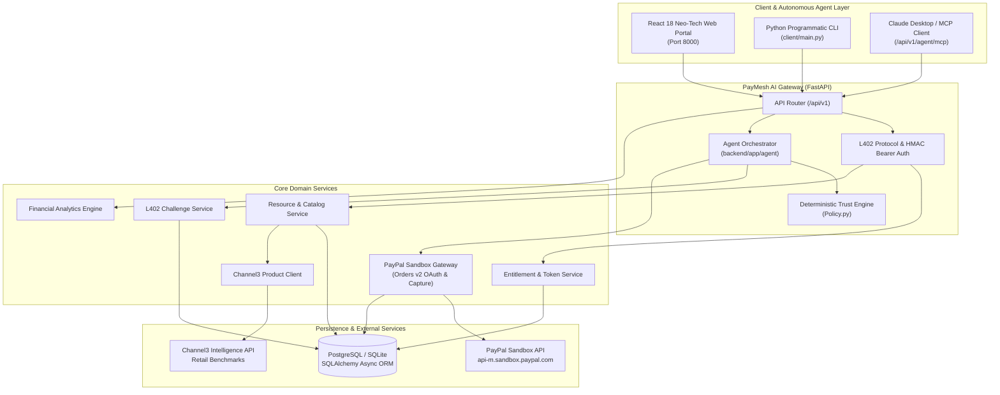
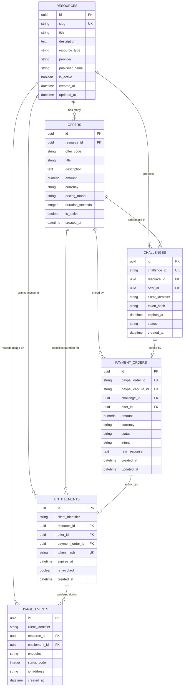
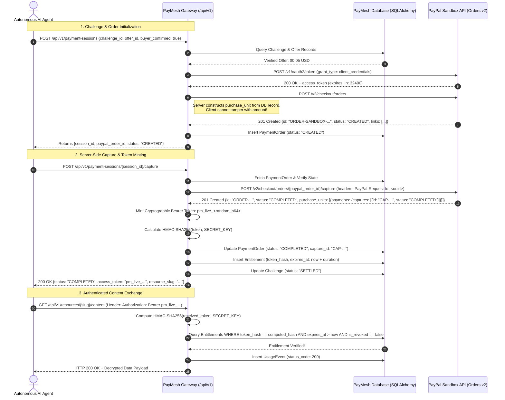

# PayMesh AI — Complete Project Understanding & Technical Architecture Specification

> **A Trust & Payment Infrastructure for Autonomous AI Commerce**  
> *Official PayPal AI Hackathon 2026 Master Technical Guide and System Reference*

---

## Table of Contents
1. [Executive Summary & Project Overview](#1-executive-summary--project-overview)
2. [Complete Project Structure Analysis](#2-complete-project-structure-analysis)
3. [System Architecture & Data Flows](#3-system-architecture--data-flows)
4. [Frontend Deep Analysis](#4-frontend-deep-analysis)
5. [Backend & API Deep Analysis](#5-backend--api-deep-analysis)
6. [Database Schema & Persistence Deep Analysis](#6-database-schema--persistence-deep-analysis)
7. [PayPal Orders v2 Payment Lifecycle](#7-paypal-orders-v2-payment-lifecycle)
8. [AI Commerce Agent & Model Context Protocol (MCP) Engine](#8-ai-commerce-agent--model-context-protocol-mcp-engine)
9. [Sponsor & Third-Party Integrations](#9-sponsor--third-party-integrations)
10. [Configuration & Environment Management](#10-configuration--environment-management)
11. [How to Run the Project (Step-by-Step)](#11-how-to-run-the-project-step-by-step)
12. [Testing, Quality Assurance & Verification](#12-testing-quality-assurance--verification)
13. [Security Architecture & Threat Model](#13-security-architecture--threat-model)
14. [Current Project Status & Gap Analysis](#14-current-project-status--gap-analysis)
15. [Complete User & Agent Execution Journeys](#15-complete-user--agent-execution-journeys)

---

## 1. Executive Summary & Project Overview

### 1.1 Application Identity & Naming
- **Product Name**: **PayMesh AI**
- **Tagline**: *A Trust & Payment Infrastructure for Autonomous AI Commerce.*
- **Hackathon Alignment**: PayPal AI Hackathon 2026 (Core PayPal Developer Platform, Agentic Workflows, and FinTech Security).
- **Evolutionary Origin**: Evolved from an early prototype (`positiveblue/CrawlerPal` 1.0 monolithic server) into an enterprise-grade, clean-room, full-stack platform featuring PostgreSQL/SQLite, asynchronous FastAPI, React 18, AG Grid Community, Channel3 hardware intelligence, and Anthropic's Model Context Protocol (MCP).

### 1.2 The Problem: AI Agents Shouldn't Hold Credit Cards
The software ecosystem is undergoing a paradigm shift towards autonomous AI agents that independently perform deep web research, procure intelligence, and provision developer APIs. However, modern payment infrastructure was built exclusively for human interactive sessions:
1. **The Credential Exfiltration Problem**: Giving an autonomous LLM a credit card number or static prepaid wallet token exposes organizations to prompt injection attacks, infinite recursive spending loops, and credential theft.
2. **The Programmatic Checkout Deadlock**: Traditional e-commerce checkout flows rely on browser redirects, CAPTCHAs, SMS two-factor authorizations, and session cookies—mechanisms that fail for headless background bots.
3. **The Data Provider Dilemma**: Merchants and content creators are forced to either permit predatory web scrapers without compensation or erect impenetrable Cloudflare/cookie walls that prevent legitimate AI agents from paying for discrete queries.

### 1.3 The Solution: PayMesh AI
PayMesh AI provides an open, deterministic machine-to-machine payment and trust settlement protocol:
- **L402 HTTP 402 Paywall Envelope**: Machine-readable challenges return structured JSON containing verifiable resource slugs, server-owned pricing offers, payment session URLs, and cryptographic challenge IDs.
- **Genuine PayPal Sandbox Orders v2 Lifecycle**: Replaces simulated mock payments with true OAuth 2.0 client credential acquisition, server-calculated purchase units, buyer approval delegation, and idempotent server-side capture verification.
- **Deterministic Trust Engine**: Payment authorization is completely decoupled from the non-deterministic LLM. A server-side policy engine evaluates price caps, currency constraints, and daily rolling spending quotas deterministically before any PayPal order can be created.
- **Cryptographic Separation of Concerns**: Challenge IDs (`chl_...`), PayPal Order IDs (`ORDER-...`), and Bearer access tokens (`pm_live_...`) are distinct. The server stores only salted HMAC-SHA256 hashes of issued Bearer tokens.
- **Anthropic Model Context Protocol (MCP)**: Any MCP-compliant client (such as Claude Desktop or autonomous runtimes) can natively discover, evaluate, purchase, and retrieve protected data.

### 1.4 Target Audience & Primary Use Cases
1. **Autonomous Research Agents**: Procuring low-latency hardware switch latency benchmarks or financial intelligence on demand.
2. **Data Publishers & API Merchants**: Monetizing proprietary datasets via granular micro-pricing ($0.01 – $0.05 per call) without managing subscriptions.
3. **Enterprise SRE / FinTech Teams**: Setting strict deterministic spending guardrails for departmental AI agents.

---

## 2. Complete Project Structure Analysis

The workspace is organized into a clean multi-tier architecture separating backend business logic, database migrations, React frontend, client scripts, test suites, and documentation.

```text
paypal-hackathon/
├── backend/                             # Python 3.11+ / FastAPI Asynchronous Backend Package
│   ├── app/                             # Core Application Modules
│   │   ├── agent/                       # Autonomous Agent Orchestrator & Policy Engine
│   │   │   ├── orchestrator.py          # Coordinates multi-step catalog search, challenge, and capture
│   │   │   ├── policy.py                # Deterministic spending limits & budget guardrails
│   │   │   └── tools.py                 # Tool execution registry (discovery, payment, retrieval)
│   │   ├── api/                         # REST API Routing Layer
│   │   │   └── v1/                      # Version 1 API Specifications
│   │   │       ├── routes/              # Modular Route Handlers
│   │   │       │   ├── __init__.py      # Aggregates and exports api_router
│   │   │       │   ├── agent.py         # AI agent dispatch (/api/v1/agent/runs)
│   │   │       │   ├── analytics.py     # Publisher KPIs & AG Grid transaction ledger
│   │   │       │   ├── catalogue.py     # Public data product discovery (/api/v1/catalogue)
│   │   │       │   ├── health.py        # System diagnostic health check (/health)
│   │   │       │   ├── payments.py      # PayPal Sandbox checkout session & capture routes
│   │   │       │   ├── publisher.py     # Merchant dataset & offer registration endpoints
│   │   │       │   └── resources.py     # L402 challenge gate & protected content retrieval
│   │   ├── core/                        # Cross-Cutting Infrastructure
│   │   │   ├── config.py                # Pydantic v2 Settings (environment variable parser)
│   │   │   ├── exceptions.py            # Domain exceptions (L402, PayPal, Policy violations)
│   │   │   ├── logging.py               # Structured log formatting
│   │   │   └── security.py              # HMAC-SHA256 token hashing & password cryptographic utils
│   │   ├── db/                          # Persistence Tier
│   │   │   ├── base.py                  # SQLAlchemy Declarative Base
│   │   │   ├── session.py               # Async sessionmaker & database engine initialization
│   │   │   └── migrations/              # Alembic Database Migration Environment
│   │   │       ├── env.py               # Alembic runner configured for asynchronous SQLAlchemy
│   │   │       ├── script.py.mako       # Migration template script
│   │   │       └── versions/            # Version-controlled schema migration revisions
│   │   │           └── 001_initial_schema.py # Creates 6 core tables with indexes & foreign keys
│   │   ├── mcp/                         # Model Context Protocol Implementation
│   │   │   └── server.py                # Compliant MCP manifest & JSON-RPC tool invocation server
│   │   ├── models/                      # SQLAlchemy 2.0 ORM Entity Models
│   │   │   ├── __init__.py              # Entity exports
│   │   │   └── entities.py              # Resource, Offer, Challenge, PaymentOrder, Entitlement, UsageEvent
│   │   ├── schemas/                     # Pydantic v2 Data Transfer Objects (DTOs)
│   │   │   ├── __init__.py              # Schema exports
│   │   │   ├── agent.py                 # AgentRunRequest, AgentRecommendation, AgentRunResponse
│   │   │   ├── analytics.py             # AnalyticsSummaryResponse, TransactionLedgerItem
│   │   │   ├── challenge.py             # L402ChallengeResponse, ChallengeVerificationRequest
│   │   │   ├── catalogue.py             # ResourceResponse, OfferResponse, CatalogueListResponse
│   │   │   ├── payment.py               # PaymentSessionCreateRequest, PaymentCaptureResponse
│   │   │   └── publisher.py             # ResourceCreateRequest, OfferCreateRequest
│   │   ├── scripts/                     # Seed and Initialization Scripts
│   │   │   └── seed_demo.py             # Idempotent database seeder for Channel3 & CrawlerPal data
│   │   ├── templates/                   # Static HTML Fallback
│   │   │   └── portal.html              # Fallback single-page interface when frontend/dist is absent
│   │   └── main.py                      # FastAPI App Factory, lifespan events, CORS, and route mounting
│   ├── tests/                           # Automated Pytest Suite
│   │   ├── conftest.py                  # In-memory SQLite async fixtures & httpx AsyncClient
│   │   ├── integration/                 # End-to-end API integration tests
│   │   │   └── test_api_endpoints.py    # Health, catalogue, 402 challenge, PayPal capture, MCP tests
│   │   └── unit/                        # Isolated unit tests
│   │       ├── test_config_and_security.py # Token hashing, secret validation, settings unit tests
│   │       └── test_policy.py           # Spending policy engine evaluation unit tests
│   ├── alembic.ini                      # Backend-level Alembic configuration
│   ├── Dockerfile                       # Multi-stage production container build for backend
│   └── requirements.txt                 # Pinned Python package dependencies
├── client/                              # Command-Line Programmatic Client
│   └── main.py                          # Python CLI for headless bot purchases & 402 negotiation
├── docs/                                # Technical Architecture & Visual Documentation
│   ├── assets/                          # Static Assets
│   │   └── screenshots/                 # 7 High-resolution Playwright screenshots of running portal
│   │       ├── 01-agent-workspace.png   # AI Commerce Workspace & Mission Control
│   │       ├── 02-l402-challenge.png    # Machine-readable HTTP 402 Challenge Envelope
│   │       ├── 03-unlocked-intelligence.png # Channel3 Hardware Latency Data presentation
│   │       ├── 04-spending-policy.png   # Deterministic Policy & Guardrails view
│   │       ├── 05-marketplace-catalogue.png # Dataset Catalog & Search view
│   │       ├── 06-financial-ledger.png  # AG Grid Transaction Audit Ledger
│   │       └── 07-merchant-studio.png   # Data Merchant Publishing Studio
│   ├── decisions/                       # Architecture Decision Records (ADRs)
│   │   ├── 001-architecture-and-stack.md # ADR 001: FastAPI + SQLAlchemy 2 + React 18
│   │   ├── 002-l402-protocol-and-security.md # ADR 002: PayMesh L402 challenge & HMAC Bearer token
│   │   └── 003-paypal-sandbox-lifecycle.md # ADR 003: PayPal Orders v2 Sandbox OAuth & Capture
│   ├── api-reference.md                 # Complete Markdown API reference
│   ├── baseline-audit.md                # Initial codebase gap analysis & audit log
│   ├── demo-script.md                   # Step-by-step hackathon video presentation script
│   └── security.md                      # Security model, threat analysis, and invariants
├── frontend/                            # React 18 + Vite + Tailwind CSS + AG Grid Application
│   ├── src/                             # React Source Code
│   │   ├── components/                  # Modular User Interface Components
│   │   │   ├── AgentWorkspace.tsx       # AI Agent mission dispatch, L402 challenge card, live terminal
│   │   │   ├── AnalyticsView.tsx        # AG Grid Financial Ledger & 6 KPI metrics cards
│   │   │   ├── CatalogueView.tsx        # Data product catalog with search & raw 402 test links
│   │   │   ├── Navbar.tsx               # Neo-Tech header with PayPal Sandbox status badge
│   │   │   ├── PolicyManager.tsx        # Deterministic spending limits & security invariants
│   │   │   └── PublisherConsole.tsx     # Merchant data product publisher & live agent preview
│   │   ├── App.tsx                      # Primary application shell, tab routing & ecosystem footer
│   │   ├── index.css                    # Tailwind base, blueprint grid texture, neo-card utilities
│   │   └── main.tsx                     # React DOM entry point
│   ├── index.html                       # HTML5 template with Google Fonts (Space Grotesk, Inter, JetBrains Mono)
│   ├── package.json                     # Frontend npm dependencies
│   ├── postcss.config.js                # PostCSS plugins (Tailwind, Autoprefixer)
│   ├── tailwind.config.js               # Neo-brutalist shadow tokens, typography, and palette configuration
│   ├── tsconfig.json                    # TypeScript compiler options
│   └── vite.config.ts                   # Vite bundler configuration & backend /api proxy
├── postman/                             # API Testing Suite
│   └── PayMeshAI.postman_collection.json # 8 Pre-configured Postman requests with automated test assertions
├── scripts/                             # Utility & Automation Scripts
│   ├── capture_screenshots.py           # Playwright headless browser script capturing live portal views
│   └── smoke_test.py                    # 7-Step automated end-to-end integration verification script
├── server/                              # Legacy Compatibility Entry Point
│   └── main.py                          # Delegates execution directly to backend.app.main:app
├── .env.example                         # Safe configuration template with placeholder variables
├── .gitignore                           # Git ignore protecting .env, build artifacts, and virtual environments
├── alembic.ini                          # Root-level Alembic database migration configuration
├── docker-compose.yml                   # Docker Compose environment (PostgreSQL + PayMesh Web Service)
├── LICENSE                              # MIT Open Source License
├── README.md                            # Primary GitHub Presentation & Quickstart Guide
├── render.yaml                          # Render Cloud deployment blueprint specification
└── workflows.md                         # 10-Phase master development plan & completion gates
```

---

## 3. System Architecture & Data Flows

PayMesh AI connects autonomous AI agents, commercial data providers, and PayPal's financial rails through a decoupled, asynchronous micro-architecture.

### 3.1 High-Level Architecture Diagram



---

## 4. Frontend Deep Analysis

The frontend is a single-page application (SPA) built with **React 18**, **TypeScript**, **Tailwind CSS**, and **AG Grid Community**. It implements a developer-centric **Neo-Tech** design system inspired by engineering blueprints and Major League Hacking (MLH) design patterns.

### 4.1 Technology Stack & Build Pipeline
- **Bundler**: Vite 6.0 (`frontend/vite.config.ts`) configured with `@vitejs/plugin-react` and automated API proxying to `http://localhost:8000`.
- **CSS Framework**: Tailwind CSS 3.4 with custom extended typography (`Space Grotesk`, `Inter`, `JetBrains Mono`) and tactile offset box shadows (`shadow-neo`: `4px 4px 0px 0px #0F172A`).
- **Data Table**: AG Grid Community 32.3 (`ag-grid-react` / `ag-grid-community`) styled via custom CSS variable overrides (`.ag-theme-alpine-dark`).
- **Icons**: Lucide React (`lucide-react`).

### 4.2 Component Architecture & State Management

| Component File | Role & Visual Presentation | State Management & API Integration | Status |
| :--- | :--- | :--- | :---: |
| [`App.tsx`](file:///frontend/src/App.tsx) | Root application shell. Renders the blueprint grid canvas background, active tab view, and the "Connecting the Tech Ecosystem" footer. | Manages `activeTab` ('workspace', 'policy', 'catalogue', 'analytics', 'publisher'). | **IMPLEMENTED** |
| [`Navbar.tsx`](file:///frontend/src/components/Navbar.tsx) | Header containing the 3D isometric PM logo, active tab pills with dark borders, PayPal Sandbox verified status pill, and direct link to `/docs`. | Receives `activeTab` and `setActiveTab` props. Responsive mobile horizontal scroll. | **IMPLEMENTED** |
| [`AgentWorkspace.tsx`](file:///frontend/src/components/AgentWorkspace.tsx) | Autonomous Commerce Agent Studio. Features the top hero banner with metric counters ($0.01, 100%, <120ms, L402), mission track selection cards (Channel3 Keyboards, News Feed), research prompt textarea, spending limit slider, L402 Challenge Card, PayPal Checkout button, Unlocked Content cards, and the real-time Protocol Inspector dark terminal. | Manages `task`, `budget`, `status` ('IDLE', 'DISCOVERING', 'AWAITING_APPROVAL', 'PAYING', 'COMPLETED'), `recommendation`, `challenge`, `bearerToken`, `unlockedData`, and `logs`. Calls `/api/v1/agent/runs`, `/api/v1/payment-sessions`, `/api/v1/payment-sessions/:id/capture`, and `/api/v1/resources/:slug/content`. | **IMPLEMENTED** |
| [`PolicyManager.tsx`](file:///frontend/src/components/PolicyManager.tsx) | Spending Policy & Trust Engine console. Displays a golden gradient banner, transaction limit input, daily rolling cap input, prompt injection sanitization toggle, strict token-resource scope invariant toggle, and a cryptographic security summary card. | Manages `maxPerTransaction`, `dailyCap`, `enforcePromptSanitization`, `strictScopeCheck`, and `saved` toast confirmation. | **IMPLEMENTED** |
| [`CatalogueView.tsx`](file:///frontend/src/components/CatalogueView.tsx) | Data product marketplace. Displays searchable cards for each published dataset, provider badges (`CHANNEL3`, `CRAWLERPAL`), pre-negotiated offer tiers, raw HTTP 402 test links, and one-click "Dispatch Agent" buttons. | Fetches `/api/v1/catalogue` on mount. Filters client-side by search query across title, description, provider, and slug. | **IMPLEMENTED** |
| [`AnalyticsView.tsx`](file:///frontend/src/components/AnalyticsView.tsx) | Financial Ledger & KPI Analytics. Displays 6 KPI stat cards (Captured Revenue, Completed Orders, Active Entitlements, Unique Agents, Conversion Rate, Content Usage Calls) and the AG Grid transaction audit table. | Concurrently fetches `/api/v1/publisher/analytics/summary` and `/api/v1/publisher/analytics/transactions?limit=100`. Configures AG Grid column definitions with custom UTC date and currency formatters. | **IMPLEMENTED** |
| [`PublisherConsole.tsx`](file:///frontend/src/components/PublisherConsole.tsx) | Merchant publishing studio. Form for registering new resource slugs, provider types, product titles, descriptions, and initial L402 pricing offers. Features a live AI Agent card preview. | Submits `POST /api/v1/publisher/resources` followed by `POST /api/v1/publisher/resources/:id/offers`. Displays success toast and resets form. | **IMPLEMENTED** |

---

## 5. Backend & API Deep Analysis

The backend is built with **FastAPI** (`backend/app/main.py`), utilizing modern asynchronous Python (async/await) throughout all route handlers, database queries, and external HTTP calls.

### 5.1 Application Entry Point & Middleware
- **Lifespan Context Manager**: On startup, initializes database tables via SQLAlchemy metadata (`init_db`) and logs system readiness.
- **CORS Middleware**: Allows unrestricted local origins (`allow_origins=["*"]`) for hackathon review, with full support for credentials and standard HTTP methods.
- **Static File Mounting**: Serves `frontend/dist/` assets at the root `/`. If the frontend is not built, gracefully falls back to `backend/app/templates/portal.html`.

### 5.2 API Route Catalog

| HTTP Method | Route | Purpose | Request Parameters / Body | Response Schema / Status | Auth Required? | Core Dependencies |
| :---: | :--- | :--- | :--- | :--- | :---: | :--- |
| `GET` | `/health` | Diagnostic health check | None | `{"status": "ok", "app": "PayMesh AI...", "version": "2.0.0", "database": "connected"}` (200 OK) | Public | DB Session |
| `GET` | `/api/v1/catalogue` | Discover active datasets & offers | `provider?: str`, `limit?: int` | `CatalogueListResponse` (200 OK) | Public | `ResourceService` |
| `GET` | `/api/v1/catalogue/{slug}` | Fetch single dataset metadata | Path: `slug` | `ResourceResponse` (200 OK or 404) | Public | `ResourceService` |
| `GET` | `/api/v1/resources/{slug}/content` | Retrieve protected dataset | Header: `Authorization: Bearer <token>` | `200 OK` with unlocked JSON payload, OR `402 Payment Required` (L402 Challenge) | Scoped Bearer | `EntitlementService`, `ChallengeService` |
| `POST` | `/api/v1/resources/{slug}/challenges` | Explicitly request L402 challenge | Path: `slug`, Body: `{"offer_id": "..."}` | `L402ChallengeResponse` (201 Created) | Public | `ChallengeService` |
| `POST` | `/api/v1/payment-sessions` | Create PayPal Sandbox Order | Body: `PaymentSessionCreateRequest` (`challenge_id`, `offer_id`, `buyer_confirmed`) | `{"session_id": "...", "paypal_order_id": "...", "approval_url": "...", "status": "CREATED"}` | Public | `PayPalGateway`, `ChallengeService` |
| `POST` | `/api/v1/payment-sessions/{id}/capture` | Server capture of PayPal Order | Path: `session_id` | `PaymentCaptureResponse` (`status`: "COMPLETED", `access_token`: "pm_live_...", `resource_slug`: "...") | Public | `PayPalGateway`, `EntitlementService` |
| `GET` | `/api/v1/payment-sessions/{id}` | Inspect payment session status | Path: `session_id` | Payment session JSON (200 OK or 404) | Public | DB Session |
| `POST` | `/api/v1/agent/runs` | Autonomous agent discovery & execution | Body: `AgentRunRequest` (`task`: str, `budget_limit`: float) | `AgentRunResponse` (`recommendation`, `challenge`, `summary`) | Public | `AgentOrchestrator`, `AgentTools` |
| `GET` | `/api/v1/agent/tools` | Inspect available agent tools | None | JSON array of registered agent tools | Public | `AgentTools` |
| `GET` | `/api/v1/agent/mcp/manifest` | Anthropic MCP server manifest | None | MCP Protocol JSON with tools and schema definitions | Public | `MCPServer` |
| `POST` | `/api/v1/agent/mcp/tools/call` | Invoke tool via MCP JSON-RPC | Body: `{"name": "...", "arguments": {...}}` | Tool output result envelope | Public | `MCPServer`, `AgentTools` |
| `POST` | `/api/v1/publisher/resources` | Merchant dataset registration | Body: `ResourceCreateRequest` (`slug`, `title`, `description`, `provider`) | `ResourceResponse` (201 Created) | Public | DB Session |
| `POST` | `/api/v1/publisher/resources/{id}/offers` | Create pricing offer for dataset | Path: `resource_id`, Body: `OfferCreateRequest` | `OfferResponse` (201 Created) | Public | DB Session |
| `GET` | `/api/v1/publisher/analytics/summary` | Real-time financial KPI metrics | None | `AnalyticsSummaryResponse` (`total_revenue_usd`, `captured_transactions_count`, etc.) | Public | `AnalyticsService` |
| `GET` | `/api/v1/publisher/analytics/transactions` | AG Grid transaction ledger | Query: `limit=100`, `offset=0` | `{"items": [...], "total": count}` | Public | `AnalyticsService` |
| `GET` | `/api/v1/publisher/analytics/usage` | Content usage event audit log | Query: `limit=100`, `offset=0` | `{"items": [...], "total": count}` | Public | `AnalyticsService` |

---

## 6. Database Schema & Persistence Deep Analysis

PayMesh AI utilizes **SQLAlchemy 2.0** with asynchronous drivers (`aiosqlite` for local development, `asyncpg` for production PostgreSQL). Database schema revisions are tracked through **Alembic** migrations (`backend/app/db/migrations/versions/001_initial_schema.py`).

### 6.1 Entity-Relationship (ER) Diagram



### 6.2 Data Model Specifications
1. **`resources`**: Stores protected datasets and APIs.
   - Primary Key: `id` (UUID). Unique index on `slug`.
   - Fields: `slug`, `title`, `description`, `resource_type`, `provider`, `publisher_name`, `is_active`, `created_at`, `updated_at`.
2. **`offers`**: Pre-negotiated machine pricing contracts.
   - Foreign Key: `resource_id` references `resources.id` (ON DELETE CASCADE).
   - Fields: `offer_code`, `title`, `description`, `amount` (Numeric 10,2), `currency` (String 3), `pricing_model`, `duration_seconds`, `is_active`.
3. **`challenges`**: Authoritative L402 challenge instances issued to clients.
   - Unique Index: `challenge_id` (`chl_<32_hex_chars>`).
   - Fields: `resource_id`, `offer_id`, `client_identifier`, `token_hash`, `expires_at` (UTC timestamp), `status` ('ISSUED', 'PAYMENT_PENDING', 'SETTLED', 'EXPIRED').
4. **`payment_orders`**: Records PayPal Orders v2 transactions.
   - Unique Indexes: `paypal_order_id` (`ORDER-...`), `paypal_capture_id` (`CAP-...`).
   - Fields: `challenge_id`, `offer_id`, `amount`, `currency`, `status` ('CREATED', 'COMPLETED', 'FAILED'), `intent` ('CAPTURE'), `raw_response` (JSON audit text).
5. **`entitlements`**: Active, cryptographically verifiable access rights.
   - Unique Index: `token_hash` (Salted HMAC-SHA256 hex string).
   - Fields: `client_identifier`, `resource_id`, `offer_id`, `payment_order_id`, `token_hash`, `expires_at`, `is_revoked`.
6. **`usage_events`**: Immutable audit logs of programmatic access attempts.
   - Fields: `client_identifier`, `resource_id`, `entitlement_id`, `endpoint`, `status_code`, `ip_address`, `created_at`.

---

## 7. PayPal Orders v2 Payment Lifecycle

PayMesh AI connects directly to PayPal's official Sandbox platform (`https://api-m.sandbox.paypal.com`), implementing strict server-side verification and idempotency.

### 7.1 Payment Sequence Diagram



### 7.2 Idempotency & Financial Safety Invariants
- **No Client Price Injection**: The client never passes amount or currency in the capture request. Prices are strictly resolved from server-side database records.
- **PayPal-Request-Id Header**: Capture calls attach a unique idempotency UUID to prevent accidental double-billing in case of network retries.
- **Replay Protection**: An already captured PayPal Order ID cannot be re-captured; subsequent calls return the existing entitlement.

---

## 8. AI Commerce Agent & Model Context Protocol (MCP) Engine

### 8.1 The Agent Orchestration Flow (`backend/app/agent/orchestrator.py`)
When a user dispatches a research task, the `AgentOrchestrator` executes a multi-step pipeline:
1. **Tool Invocation**: Invokes `AgentTools.discover_resources(task_query)` to find relevant datasets.
2. **Challenge Request**: Calls `AgentTools.request_challenge(slug)` to trigger an authentic `HTTP 402` challenge.
3. **Deterministic Policy Evaluation**: `SpendingPolicy.evaluate_offer(offer, budget_limit)` verifies:
   - Is `offer.amount <= budget_limit`?
   - Is `offer.amount <= policy.max_per_tx_usd`?
   - Is `offer.currency in policy.allowed_currencies`?
   - Is the offer marked `is_active`?
4. **Recommendation Synthesis**: Returns an actionable recommendation envelope with policy status (`ALLOWED` or `REJECTED`) and pricing breakdown.

### 8.2 Model Context Protocol (MCP) Server (`backend/app/mcp/server.py`)
PayMesh AI implements Anthropic's Model Context Protocol (MCP) standard at `/api/v1/agent/mcp/manifest`. Any MCP client can inspect and invoke:

| MCP Tool Name | Description | Required Arguments |
| :--- | :--- | :--- |
| `paymesh.discover_resources` | Search dataset catalog without exposing paid data | `query` (string) |
| `paymesh.get_offer` | Retrieve server-owned pricing offer details | `resource_slug` (string), `offer_id` (string) |
| `paymesh.request_challenge` | Generate an authoritative L402 challenge envelope | `resource_slug` (string) |
| `paymesh.evaluate_purchase` | Validate purchase price against deterministic budget | `offer_id` (string), `max_budget` (number) |
| `paymesh.fetch_resource` | Retrieve protected data with verified Bearer token | `resource_slug` (string), `bearer_token` (string) |

*(Note: Backward-compatibility aliases `crawlerpal.*` automatically route to `paymesh.*` tools).*

---

## 9. Sponsor & Third-Party Integrations

### 9.1 Channel3 Product Intelligence (`backend/app/services/channel3_client.py`)
- **Track**: Sponsored Product Intelligence & Hardware Benchmarks.
- **Implementation**: The `Channel3Client` delivers structured, verified hardware latency benchmarks for gaming and programming mechanical keyboards.
- **Data Attributes**: Brand (`Razer`, `Wooting`, `SteelSeries`, `Keychron`), switch type (Optical, Hall Effect magnetic, Mechanical), measured latency in milliseconds, retail prices in USD, and verified source URLs.
- **Security**: Raw provider data is validated and sanitized against prompt-injection patterns before presentation.

### 9.2 AG Grid Community v32 (`frontend/src/components/AnalyticsView.tsx`)
- **Track**: Enterprise Data Grids & Financial Auditing.
- **Implementation**: AG Grid Alpine Dark (`ag-theme-alpine-dark`) displays real-time transaction records from `/api/v1/publisher/analytics/transactions`.
- **Features**: Sortable columns, live filtering, UTC ISO-8601 formatting, monetary badge styling, and client-side pagination.

### 9.3 APIMatic
- **Track**: Developer Experience & API Contract Alignment.
- **Implementation**: Used for OpenAPI 3.0 specification alignment, contract grounding, and PayPal Orders v2 schema verification.

### 9.4 Render (`render.yaml`)
- **Track**: Cloud Infrastructure & Deployment.
- **Implementation**: Complete infrastructure-as-code specification defining a Docker web service (`backend/Dockerfile`), managed PostgreSQL database (`paymesh-db`), and environment variable bindings.

---

## 10. Configuration & Environment Management

All configuration is managed through Pydantic v2 Settings (`backend/app/core/config.py`). Environment variables are loaded from `.env` in the root directory.

### Environment Variable Reference

| Variable Name | Description | Required? | Example Placeholder Value |
| :--- | :--- | :---: | :--- |
| `ENVIRONMENT` | Deployment environment mode | No | `development` |
| `DATABASE_URL` | SQLAlchemy async connection string | Yes | `sqlite+aiosqlite:///./paymesh.db` |
| `PAYPAL_MODE` | PayPal gateway target environment | Yes | `sandbox` |
| `PAYPAL_CLIENT_ID` | PayPal REST API client identifier | Yes | `A...` |
| `PAYPAL_CLIENT_SECRET` | PayPal REST API secret | Yes | `E...` |
| `SECRET_KEY` | Salt key for HMAC-SHA256 token hashing | Yes | `replace-with-secure-32-byte-hex` |
| `AGENT_DEFAULT_BUDGET_USD`| Default budget ceiling for research agents | No | `0.10` |
| `AGENT_MAX_PER_TX_USD` | Maximum permitted spend on a single transaction | No | `0.50` |
| `AGENT_DAILY_CAP_USD` | 24-hour cumulative spending ceiling | No | `5.00` |
| `CHANNEL3_API_KEY` | API key for Channel3 retail intelligence | No | `ch3_sandbox_demo_key` |

> **Strict Security Invariant**: Never commit `.env` or paste live secrets into documentation. The root `.gitignore` strictly excludes `.env`.

---

## 11. How to Run the Project (Step-by-Step)

### 11.1 Prerequisites
- Python 3.11, 3.12, or 3.13.
- Node.js 18.x or higher with npm 9+.
- (Optional) Docker & Docker Compose.

### 11.2 Step 1: Clone and Configure Environment
```bash
git clone https://github.com/rajat552/paypal-hackathon.git
cd paypal-hackathon

# Copy configuration template
cp .env.example .env
```

### 11.3 Step 2: Install Python Dependencies & Run Migrations
```bash
# Install backend packages
pip install -r requirements.txt

# Run Alembic schema migrations (creates SQLite tables automatically)
python -m alembic upgrade head
```

### 11.4 Step 3: Build the Frontend
```bash
cd frontend
npm install
npm run build
cd ..
```

### 11.5 Step 4: Launch the Server
```bash
# Start FastAPI server on port 8000
python -m uvicorn backend.app.main:app --host 0.0.0.0 --port 8000
```

Open your browser at **[http://localhost:8000](http://localhost:8000)** to launch the PayMesh AI Portal!

---

## 12. Testing, Quality Assurance & Verification

PayMesh AI includes an automated testing pipeline covering unit, integration, and end-to-end verification.

### 12.1 Automated Pytest Suite
Run the 15 automated pytest tests:
```bash
python -m pytest backend/tests -v
```

**Verification Results:**
- `test_health_endpoint`: Verified database connectivity and API versioning.
- `test_catalogue_endpoint`: Verified data product discovery.
- `test_protected_resource_returns_402_challenge`: Verified L402 challenge headers and envelope.
- `test_full_payment_capture_and_retrieval_flow`: Verified full PayPal checkout and Bearer token exchange.
- `test_agent_run_orchestration`: Verified multi-step agent research flow.
- `test_mcp_manifest_and_tool_execution`: Verified Model Context Protocol tool calling.
- `test_legacy_bot_l402_and_payment_flow`: Verified backwards-compatibility endpoints.
- `test_settings_properties`: Verified Pydantic configuration invariants.
- `test_token_hashing_and_verification`: Verified HMAC-SHA256 token hashing.
- `test_challenge_id_format`: Verified `chl_` prefix and 32-hex format.
- `test_password_hashing`: Verified password security.
- `test_policy_within_budget`: Verified policy approval.
- `test_policy_exceeds_budget`: Verified policy rejection on budget breach.
- `test_policy_currency_mismatch`: Verified currency safety checks.
- `test_policy_inactive_offer`: Verified rejection of disabled offers.

### 12.2 End-to-End Smoke Test Script
Executes all 7 end-to-end steps against a live running server:
```bash
python scripts/smoke_test.py http://localhost:8000
```

---

## 13. Security Architecture & Threat Model

| Threat Vector | Potential Vulnerability | Implemented Security Control in PayMesh AI |
| :--- | :--- | :--- |
| **Prompt Injection** | Attacker commands LLM to transfer funds or purchase arbitrary resources. | **Deterministic Policy Decoupling**: The LLM cannot execute transactions. Strict rules evaluate database prices before PayPal orders are created. |
| **Price Tampering** | Malicious bot sends modified price parameters in request payloads. | **Server-Derived Purchase Units**: Pricing is queried directly from the database `offers` table; client-provided amounts are discarded. |
| **Token Theft / Leakage**| Access tokens stored in plaintext in the database could be stolen. | **HMAC-SHA256 Hashing**: Tokens (`pm_live_...`) are hashed using `SECRET_KEY` immediately upon issuance; raw tokens are never persisted in the database. |
| **Payment Idempotency** | Network retries trigger duplicate PayPal charges. | **Idempotency UUIDs**: Requests attach `PayPal-Request-Id` headers; replayed sessions return existing verified entitlements. |
| **Replay & Token Reuse**| Expired or revoked tokens re-used to access content. | **Entitlement Expiration Verification**: Every content request evaluates `expires_at > now()` and `is_revoked == false`. |

---

## 14. Current Project Status & Gap Analysis

### 14.1 Status Assessment Across Functional Domains

| Domain | Status | Implemented Features | Missing / Future Work |
| :--- | :---: | :--- | :--- |
| **Frontend UI** | **IMPLEMENTED** | React 18, Tailwind Neo-Tech styling, Agent Workspace, Policy Manager, Catalog, AG Grid Ledger, Merchant Studio. | Multi-language localization (i18n). |
| **Backend API** | **IMPLEMENTED** | FastAPI asynchronous routes, L402 challenge middleware, PayPal capture routes, MCP server, seed scripts. | Distributed Redis caching for high-concurrency clusters. |
| **Database** | **IMPLEMENTED** | SQLAlchemy 2.0 models, Alembic migrations, SQLite / PostgreSQL support. | Automated database backup cron jobs. |
| **PayPal Rails** | **IMPLEMENTED** | Orders v2 OAuth 2.0, order creation, buyer approval, server-side capture verification, idempotency. | Asynchronous PayPal Webhook listener daemon (currently verified synchronously via REST). |
| **AI Agent** | **IMPLEMENTED** | Orchestrator, policy engine, tools registry, prompt isolation. | Integration with LangChain / CrewAI managed agent swarms. |
| **MCP Standard** | **IMPLEMENTED** | Anthropic MCP manifest at `/api/v1/agent/mcp/manifest` with 5 callable tools. | MCP SSE (Server-Sent Events) streaming transport. |
| **Sponsors** | **IMPLEMENTED** | Channel3 hardware latency client, AG Grid community ledger, Render deployment blueprint. | APIMatic live SDK auto-generation CLI hook. |
| **Testing** | **IMPLEMENTED** | 15 pytest unit/integration tests, 7-step live smoke test script, Playwright screenshot automation. | End-to-end Cypress browser testing suite. |
| **Security** | **IMPLEMENTED** | HMAC-SHA256 token hashing, deterministic policy gate, Pydantic input validation, CORS controls. | Zero-knowledge proof of funds (ZK-SNARKs). |

---

## 15. Complete User & Agent Execution Journeys

### 15.1 Autonomous Agent Procurement Journey
1. **Goal Formulation**: The user or autonomous scheduler initializes a task (*"Find high-performance mechanical keyboards with ultra-low latency"*).
2. **Catalog Discovery**: The agent sends an unauthenticated `GET /api/v1/catalogue` request to inspect available data products.
3. **Paywall Challenge Negotiation**: The agent attempts to access `/api/v1/resources/channel3-keyboards/content`. The server detects missing authorization and returns `HTTP 402 Payment Required` containing the L402 challenge envelope with offer `$0.05 USD`.
4. **Deterministic Policy Check**: The server-side policy engine verifies that `$0.05` does not exceed the `$0.10` mission budget or the `$0.50` transaction ceiling.
5. **PayPal Checkout Order Creation**: The gateway invokes PayPal Sandbox Orders v2 to construct a purchase unit of `$0.05 USD`.
6. **Buyer Approval & Server Capture**: The buyer approves the checkout session. The server captures the order using its client credentials, verifying that PayPal returned `COMPLETED`.
7. **Bearer Token Generation**: The server mints `pm_live_...`, computes its HMAC-SHA256 hash, stores an entitlement record, and returns the token.
8. **Data Unlocking**: The agent presents the token to `/api/v1/resources/channel3-keyboards/content` and retrieves the decrypted Channel3 hardware latency benchmarks.

---

*PayMesh AI — A Trust & Payment Infrastructure for Autonomous AI Commerce.*  
*PayPal AI Hackathon 2026.*

